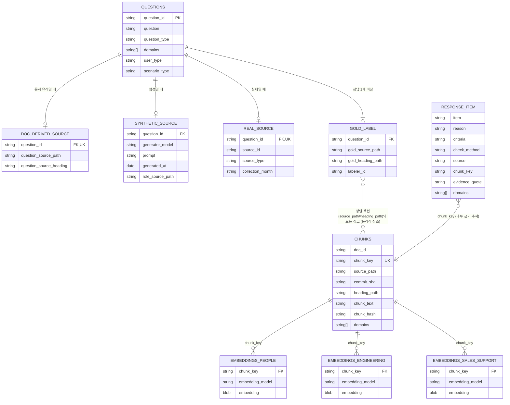

# ERD — 온보딩 체크리스트 RAG 최소 DB

> `docs/기획v1.md` 3절 "PoC 공통 기준"·"평가 질문 유형"·`.agent/DECISIONS.md`(DEC-013~022)에 흩어진 스키마 결정을 하나의 다이어그램으로 모은 것이다. 컬럼·규칙은 원본 문서가 기준이며, 구현은 도메인별로 자유롭다(3절) — 이 ERD는 **합칠 때 맞아야 하는 최소 구조**만 보여준다.

## 전체 구조

## 핵심 규칙 (근거)

### 1. `chunk_key` — 중복 제거·조인의 기준 (DEC-013·014·015)

`CHUNKS`의 중복 제거 기준은 **네 값의 조합** `(source_path, commit_sha, heading_path, chunk_hash)`다(기획v1 3절). 이 ERD는 임베딩 표가 원문 청크를 가리킬 수 있도록 그 조합으로 계산한 **단일 `chunk_key`** 를 `CHUNKS`에 두는 안을 제안한다 — 모든 도메인이 같은 방식으로 계산해야 합칠 때 임베딩이 원문을 찾는다(예: 네 값을 구분자로 이어 붙인 문자열의 해시). 구현은 네 컬럼 복합키를 쓰는 것도 허용하되, 그 경우 임베딩 표에도 네 컬럼을 그대로 둔다. **어느 쪽으로 통일할지는 팀 확인 후 결정 기록(DEC)으로 남긴다.** 기획v1 3절 최소 구조의 `doc_id`는 문서 단위 식별자로 `CHUNKS`에 유지한다. `chunk_hash`는 "공백 정리"(연속 공백·탭·줄바꿈을 한 칸으로, 앞뒤 제거, 구두점·대소문자는 보존 — DEC-019)를 적용한 `chunk_text`의 해시. 도메인이 같은 텍스트를 다르게 청킹하면 `chunk_hash`가 달라져 둘 다 남는다 — **의도된 동작**이다.

### 2. 임베딩은 왜 도메인별로 분리하나 (`기획v1.md` 3절)

`CHUNKS`에는 임베딩을 넣지 않는다. 도메인마다 임베딩 모델을 자유롭게 고르므로(4절), 모델이 다르면 벡터 공간도 달라 한 컬럼에 못 담는다. 검색은 "질문의 `domains` 후보에 포함되는 청크를 그 도메인의 임베딩 모델로 비교"하는 구조다. 합칠 때 원문 청크(`CHUNKS`)만 중복 제거하고, 임베딩 테이블은 도메인 수만큼 그대로 둔다.

### 3. `domains`는 배열 (공용 폴더 대응)

공용 폴더 6개(company·about·values·communication·tools-and-tips·upstream-studios)는 여러 도메인이 색인할 수 있다. 합칠 때 같은 청크를 하나로 합치고 `domains`는 합집합으로 보존한다 — 한 도메인 값만 남기면 다른 도메인의 검색에서 그 청크가 사라진다.

### 4. 질문 3종 — 출처별 보조 테이블 (DEC-012·013·016·021)

`QUESTIONS`는 공통 필드만 갖고, 출처별 세부는 `question_type`에 따라 셋 중 하나에만 채운다:

| `question_type` | 보조 테이블 | 핵심 필드 | 최종 모델 선택에 쓰나 |
|---|---|---|---|
| 문서 유래 | `DOC_DERIVED_SOURCE` | `question_source_path` (FAQ 위치) | 아니오 — 동작 확인용 (DEC-014) |
| 합성 | `SYNTHETIC_SOURCE` | `generator_model`, `prompt`, `role_source_path` | **예** (조건부, DEC-021) |
| 실제 | `REAL_SOURCE` | `source_id`(비식별), `collection_month` | 확보되면 추가 비교 (DEC-016) |

`GOLD_LABEL`은 세 유형 모두 공통이며 **질문 하나에 정답 행이 여러 개**일 수 있다(체크리스트 질문은 여러 문서가 근거일 수 있다). 정답은 **섹션 단위**(`gold_source_path#gold_heading_path`)이고 **`gold_heading_path`는 `CHUNKS.heading_path`와 완전히 같은 생성·정규화 규칙**(H2~H4 전체 경로를 `>`로 이은 값)을 쓴다 — 같은 `Setup`이라는 하위 제목이 다른 상위 제목 아래 여럿 있어도 섹션이 구분된다.  한 섹션이 여러 청크로 나뉘어도 그 섹션의 어느 청크든 정답으로 인정한다. Recall@k는 "찾은 서로 다른 정답 섹션 수 ÷ 정답 섹션 전체 수", Hit@k는 "정답이 하나라도 있으면 1"이다. 정답이 정말 하나뿐인 질문만 허용하려면 그 제한을 질문 생성·검수 규칙에 적고 두 지표를 함께 쓰는 이유를 다시 정리한다. 또한 정답은 **질문 출처와 분리**(`role_source_path`와 `gold_source_path`가 같으면 그 문항은 최종 점수에서 뺀다 — 역할 설명 문서 자체가 정답이면 검색이 유리해지는 걸 막는다). 그림의 `GOLD_LABEL`은 한 청크가 아니라 **정답 섹션 전체(그 섹션의 모든 청크)**에 연결되고, `RESPONSE_ITEM`은 사람이 읽는 `source`(`path#heading`, 여러 청크가 공유할 수 있음)와 별도로 내부 `chunk_key`(사용자에게 노출하지 않는 검증·추적용)를 보존해 정확한 근거 청크를 가리킨다.

### 5. 개인정보 — 저장소에 넣지 않는 것 (DEC-016)

`REAL_SOURCE.source_id`는 사람과 무관한 임의 ID다. 질문 원문·`labeler_id`↔실명 대응표는 **저장소 밖(접근 제한 위치)에만** 둔다 — 커밋한 정보는 지워도 git 이력에 남기 때문이다. AI 세션(웹 채팅·에이전트 등)에서 질문을 만들거나 추출하거나 다듬었다면 그 세션에서 정답을 표시·검증하지 않고 다른 세션에서 한다(DEC-024가 "질문자≠정답 표시자" 규칙을 대체).

### 6. `RESPONSE_ITEM`은 테이블이 아니다

서비스 응답 시점에 조립되는 구조다(DEC-019). `source`·`domains`는 모델이 직접 쓰지 않고, 검증을 통과한 `chunk_key`의 메타데이터를 **코드가** 채운다. `source`·`evidence_quote`가 없거나 `CHUNKS` 범위 밖이면 그 항목 전체를 제거한다 — 빈 값으로 두지 않는다.

## 아직 없는 것 (미결)

- 실제 저장 엔진(SQLite/다른 선택)은 도메인별로 다를 수 있다 — `기획v1.md` 4절은 영업·지원만 "SQLite 2테이블(`chunks`+도메인별 `embeddings_*`)"로 제안했고, 인사·엔지니어링은 아직 미정.
- 질문 분류(②) 결과를 저장할 테이블(분류 정확도 평가용)은 `기획v1.md` 5절 "미결"에 남아 있고 이 ERD에는 아직 없다.
