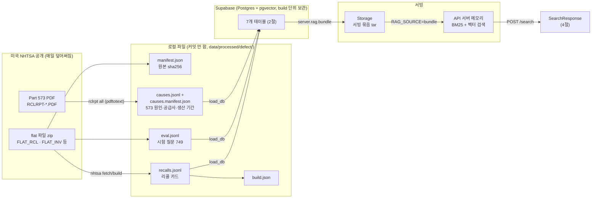
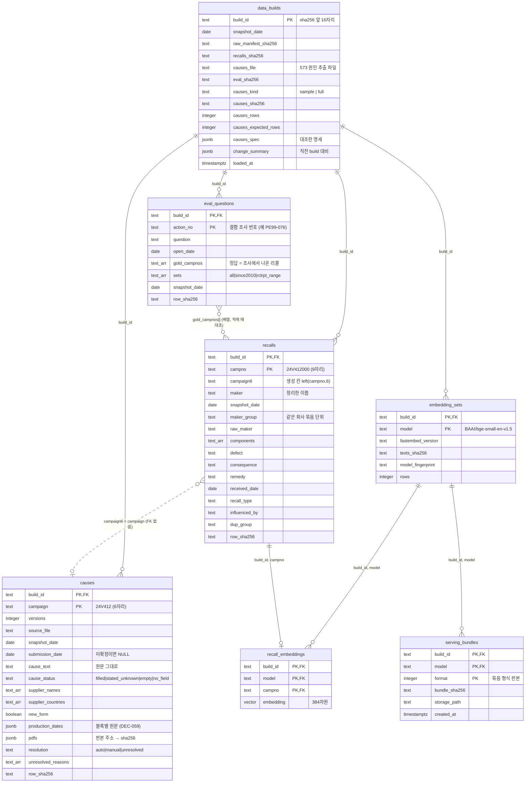
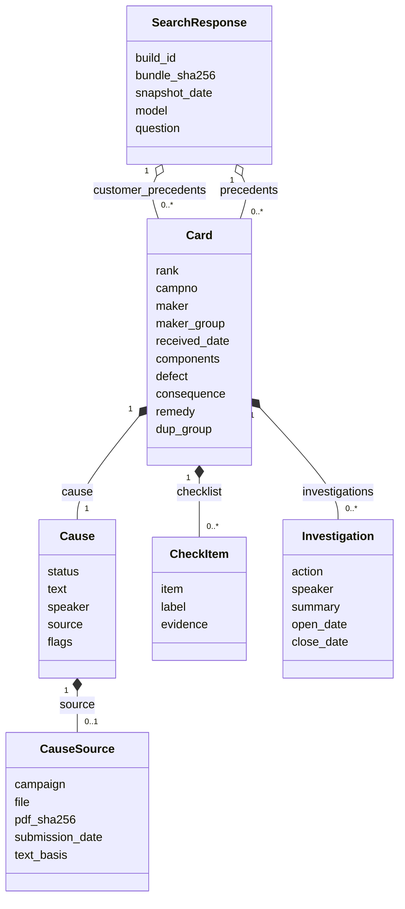

# ERD — 결함 선례 찾기 도우미 데이터 구조

> 기준: `origin/main` 763211e (2026-10-16). **이 문서는 새 설계가 아니라 이미 있는 스키마의 그림이다** — 아래 그림과 표의 칸은 `scripts/defect_precedent/schema.sql`·`server/rag/embeddings.sql`·`server/rag/bundle.sql`·`server/api.py`에서 옮겼다(계보에 중요한 칸 위주이며 **전체 칸은 SQL이 정본**). 다르면 SQL·코드가 맞고 이 문서를 고친다.
> 스키마 변경은 10/17부터 동결이다(DEC-059 ⑤). 칸을 바꾸지 않고 읽기만 하는 문서다.

## 1. 한눈에 — 데이터가 흐르는 길

- **build_id** = 입력 파일 4개(원본 명세·카드·시험지·원인 파일)의 sha256 앞 16자리. 내용이 하나라도 다르면 다른 build이고, 같은 날짜라도 덮어쓰지 않고 둘 다 남는다(schema.sql:7-9, DEC-034). 답변 → 리콜 번호 → 원본 파일 → 스냅샷 날짜를 되짚는 추적성(AGENTS.md 2-4)의 뿌리다.
- 현재 운영 build는 `5e32c164b15a544a`(생산 기간 반영, 공개 API `https://lg-cns-rag.vercel.app`)이다 — `.agent/HANDOFF.md`가 정본이고 바뀌면 거기를 따른다.

## 2. ERD — DB 테이블 7개

### 관계를 읽는 법

| 관계 | 종류 | 설명 | 근거 |
|---|---|---|---|
| `data_builds` → `recalls`·`eval_questions`·`causes`·`embedding_sets` | 외래 키(1:N) | 줄마다 `build_id`를 갖고 `(build_id, 번호)`가 기본키다. 새 build를 올려도 지난 build는 지우지 않는다 | schema.sql:7-9 |
| `embedding_sets` → `recall_embeddings`, `recalls` → `recall_embeddings` | 외래 키 | 카드 1장 = 벡터 1줄. 같은 build의 `recalls` 줄에만 붙는다 | embeddings.sql:19 |
| `embedding_sets` → `serving_bundles` | 외래 키 | `(build_id, model, format)` 마다 묶음 기록 1줄. 형식이 바뀌면 덮어쓰지 않고 새 줄 | bundle.sql:5 |
| `recalls` ⇢ `causes` | **논리 관계(FK 없음)** | `recalls.campaign6 = causes.campaign`. 한 캠페인이 `recalls` 여러 건(번호 뒤 3자리가 다른 카드)에 붙을 수 있다 | schema.sql:40 |
| `eval_questions` ⇢ `recalls` | **논리 관계(배열)** | `gold_campnos[]`는 배열이라 외래 키를 걸 수 없다. 적재 스크립트(`load_db`)가 같은 build의 `recalls.campno`와 대조한다 | schema.sql:61,68 |

### 평소 조회용 뷰와 접근 제어

- `latest_build`: **전체본(`causes_kind='full'`)이 있으면 가장 최근 날짜의 전체본**, 없을 때만 최근 표본. 날짜보다 종류가 먼저다(나중 날짜의 표본 300건이 전체본을 가리지 않게). `recalls_latest`·`eval_questions_latest`·`causes_latest`는 이 build만 고른다. 표본 전용 `*_latest_sample` 뷰도 있다.
- 모든 뷰는 `security_invoker = true`라 호출한 사람의 권한으로 읽는다(RLS를 우회하지 않는다).
- 7개 테이블 모두 **정책 없이 RLS를 켜** anon·authenticated 키로는 아무것도 읽지 못한다. 서버용 조회 전용 계정(`rag_reader`)은 배포 때 만든다(이슈 #63, DEC-042 ⑤) — 지금 로컬 서버는 관리자 연결을 `ALLOW_ADMIN_DB_FOR_SERVER=1`로 명시해 쓴다.

## 3. 칸 사전 — 의미를 오해하기 쉬운 것

| 칸 | 뜻 | 주의 |
|---|---|---|
| `recalls.campno` | NHTSA 리콜 번호 9자리(`24V412000`) | 원본 그대로. 앞 6자리가 캠페인 |
| `recalls.maker` / `maker_group` | `maker`는 신고서 이름을 정리한 이름(표기·법인 형태 통일), `maker_group`은 같은 회사로 묶어 볼 단위(회사명 대응표 확인본) | `maker_group`이 NULL이면 대응표 반영 전 build (DEC-033·036). 고객사 선례(현대·기아)는 이 칸의 허용 목록으로 먼저 보여 준다(DEC-042) |
| `recalls.dup_group` | 결함 설명 본문이 같은 리콜 묶음 | 다른 회사가 공급사의 같은 설명을 쓴 경우도 묶인다 |
| `causes.cause_status` | `filled` 원인 글 있음 / `stated_unknown` "NR·조사 중"처럼 원인 대신 적은 글(원문 보존) / `empty` 칸이 빔 / `no_field` 칸 자체가 없음 | 서버가 내보내는 응답 상태는 이보다 많다(4절) — 범위 밖·판독 실패·판본 미확정이 앞서 걸린다 |
| `causes.resolution` | 최신 판본을 고른 방식 `auto`(제출일) / `manual`(사람이 확인) / `unresolved` | `unresolved`면 어느 판본이 최신인지 짐작하지 않고 글을 싣지 않는다(AGENTS.md 2-3) |
| `causes.production_dates` | `[{label, raw, start, end}]` 블록 목록 | `raw`는 원문 그대로(공백 정리만), `start`·`end`는 `날짜 - 날짜` 형식일 때만 값이 있다(DEC-059). 겹치는지는 판단하지 않는다 |
| `causes.pdfs` | `{판본 주소: sha256}` | 응답의 `pdf_sha256`이 여기서 온다 — 원본 PDF까지 되짚는 칸 |
| `eval_questions.gold_campnos` | 정부 기록상 그 조사에서 나온 리콜 | 사람이 지어낸 정답이 아니다(AGENTS.md 5-2). 대리 평가용이고 시점 평가는 별도 시트 |
| `*.row_sha256` | 데이터 칸 전체의 해시 | build 사이에 바뀐 줄을 찾는 데 쓴다 |

## 4. API 응답 모델 (DB 밖, `server/api.py`)

DB 테이블이 아니라 `POST /search`가 돌려주는 **카드 한 장의 구조**다. 서비스 원칙(AGENTS.md 2절)이 스키마로 박혀 있다 — 판정 필드(`applies`·`verdict` 등)가 없고(`Strict`는 모르는 칸을 거부한다), 원인은 말한 주체·출처 없이는 나갈 수 없다.

- 위 그림의 `Cause`는 `status` 값으로 갈리는 5개 모델(`CauseText`·`CauseStated`·`CauseNoReport`·`CauseUnreadable`·`CauseMissingText`)을 하나로 줄였고, `CheckItem`은 `item` 값(`same_part`·`failure_mode`·`remedy`·`supplier`·`cause_speaker`·`production_period`)으로 갈린다. `Cause`의 상태 9가지(`filled` · `stated_unknown` · `no_573_report` · `report_unreadable` · `report_status_unknown` · `version_unresolved` · `cause_empty` · `cause_no_field` · `verify_failed`)는 `server/api.py`의 `Cause*` 모델이 정본이다. 글이 있는 둘(`filled`·`stated_unknown`)만 `text`·`speaker`·`source`를 갖고, 나머지는 **글 없이 상태와 되짚을 캠페인 번호만** 싣는다 — "원문에서 원인 서술을 찾지 못함"을 구조로 표현한 것이다.
- `CheckItem`의 `production_period`만 `source`(읽은 573 판본)를 반드시 갖는다 — 출처 없는 생산 기간이 응답으로 나가지 못하게 모델을 나눴다(DEC-059).
- `Investigation`(결함 조사 요약)은 DB 테이블이 아니라 서버가 로컬 원본 파일에서 읽어 붙인다(`server/rag/investigations.py`, DEC-044) — 질문의 출처이기도 해서 **검색 색인에는 넣지 않는다**(누수 방지).

## 5. 이 문서에 없는 것

- 시험지·시점 평가 시트·정답 표시 파일은 DB 테이블이 아니다(저장소 밖 또는 `data/processed/`의 파일) — `scripts/defect_precedent/README.md`와 `docs/시점평가_정답표시_안내.md`.
- 8D 작성 보조의 `EvidencePacket`(PR #139의 계획)은 아직 구현 전의 개념이라 ERD에 넣지 않았다.
- 프런트의 담기·작성 상태(`frontend/src/search/picks.ts` 등)는 브라우저 메모리 안의 값이고 저장하지 않는다.
