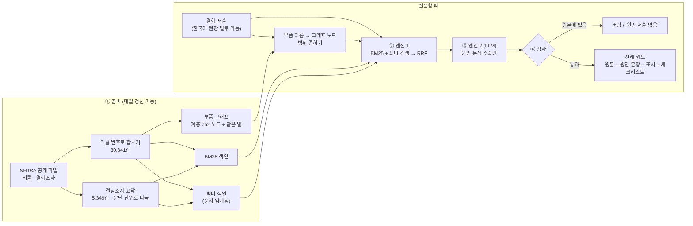

# 결함 선례 RAG — 기획·발표 7단계 (검토용 초안)

> 품질 엔지니어가 **현장 결함 서술 한 줄**(증상, 또는 "무엇이 고장 났는지")을 넣으면, **다른 제조사·같은 부품**의 과거 리콜·결함조사 선례를 원인·결과·시정조치 **원문과 함께** 찾아 주고 확인 체크리스트를 준다. **왜 생겼는지 모르는 결함**에 "그 원인을 밝혔던 선례"를 대 주는 도구다. "리콜해야 한다/안 해도 된다", "원인은 이것이다"는 말하지 않는다.
>
> 작성 2026-10-01 · 우지훈 · 틀: `docs/기획.md`와 같은 7단계
>
> **📌 이 문서의 위치**: 10/2 주제 결정 회의용 후보(N2)다. 다른 후보는 `기획_온보딩.md`(B), `기획_문서구조화.md`(B'), `기획_코드온보딩.md`(C). 주제 결정은 아직 `.agent/DECISIONS.md`에 없다.
>
> **근거 표기**: 🧪 2026-10-01 NHTSA 공개 데이터를 직접 내려받아 집계·실험한 값 — **실험 스크립트는 임시 폴더에만 있고 이 저장소에 아직 없다** (채택 시 `scripts/`로 옮김) · 🔍 원문을 열어 확인 · 🟡 2차 출처만 확인 · ⚠️ 확인 안 된 가정
> 근거 없이 채운 칸은 발표장에서 바로 질문이 들어온다 — 모르면 "아직 없음"이라고 적는다.

---

## 1. 문제 정의

### 배경 — "같은 부품을 쓴 다른 차종을 놓쳐서 112억"

2018년 BMW 차량 화재 사태에서 국토교통부는 과징금 112억 원과 형사고발을 결정했다. 지적 중 하나는 **같은 엔진·EGR 부품을 쓴 일부 차종을 리콜에서 뺐다**는 것이었다. 독일 본사는 2015년 10월에 EGR 쿨러 TF를 꾸렸는데 리콜은 2018년 7월이었다 (🔍 [서울신문 2018-12-24](https://www.seoul.co.kr/news/economy/2018/12/24/20181224500024)).

결함이 생겼을 때 "이 결함과 닮은 선례가 다른 곳에 있었나, 같은 부품을 쓰는 곳은 어디인가"를 빨리 찾는 일은 **법적 기한과 과징금이 걸린 일**이다.

| 근거 | 내용 | 확인 |
|---|---|---|
| 미국 보고 기한 | 결함이 안전 관련으로 판단되면 **5영업일 안에** 보고. 부품(장비) 제조사도 대상 (49 CFR 573.6) | 🔍 [원문](https://www.law.cornell.edu/cfr/text/49/573.6) |
| "알았어야 했다" 기준 | 기한은 실제로 안 날이 아니라 **알았어야 했던 날**부터 따진다 (규정 문언이 아니라 집행·동의명령에서 쓰는 해석) | 🟡 [Honigman](https://www.honigman.com/alert-2990) |
| 늑장 리콜 제재 (미국) | 공급사 Takata 2억 달러(2015, 역대 최대), Ford 1.65억 달러(2024) | 🟡 [Claims Journal](https://www.claimsjournal.com/news/national/2024/11/14/327420.htm), [Safety Research](https://safetyresearch.net/nhtsa-consent-orders-and-civil-justice/) |
| 늑장 시정 제재 (한국) | 결함을 안 날부터 지체 없이 시정하지 않으면 매출액 3% 이하 과징금. **자동차부품 제작사도 대상** (자동차관리법 제74조②) | 🔍 법령 전문 |
| 규제기관도 같은 일을 한다 | NHTSA 장비 조회(EQ)의 목적은 같은 공급사 부품이 들어간 다른 제조사가 모두 리콜 보고를 했는지 확인하는 것 | 🔍 [DOT 감사관실 2023 보고서](https://www.oig.dot.gov/sites/default/files/NHTSA%20ODI%20Final%20Report_5.31.23.pdf) |
| 인증 요건 | 자동차 품질 인증 IATF 16949 6.1.2.1은 위험 분석에 "리콜에서 배운 점"을 반영하라고 요구 | 🟡 [포럼 인용](https://elsmar.com/elsmarqualityforum/threads/iatf-16949-clause-6-1-2-1-lessons-learned-and-risk-analysis.73538/) (원문 유료) |
| 실무의 현실 | 스웨덴 완성차 연구: 지식 DB가 있어도 "있는 줄 모르고", "동료에게 직접 묻는 것을 선호" | 🔍 [Design Science 2019](https://www.cambridge.org/core/journals/design-science/article/knowledge-reuse-in-industrial-practice-evaluation-from-implementing-engineering-checksheets-in-industry/30C50605C0957F113F92EFFC3073E7CA) |

| 항목 | 내용 |
|---|---|
| 1차 대상 | 완성차·부품사(배터리·전장 포함)의 **품질·안전 엔지니어**. 현장 결함 신고를 받고 원인과 영향 범위를 조사하는 사람 |
| 그 사람이 처한 상황 | 현장에서 결함 신고가 몇 건 들어왔다. 반품 부품을 보면 **무엇이** 고장 났는지는 알 수 있어도, **왜** 그렇게 됐는지는 아직 모른다. 리콜 여부 판단은 회사의 법적 책임이고, 기한은 "알았어야 했던 날"부터 흐른다 |
| 없어서 못 하는 것 | **다른 제조사에서** 비슷한 증상이 무엇 때문에 생겼고, 어떻게 시정했는지 원문으로 빨리 확인할 방법 |
| 그래서 무엇이 어렵나 | 사내 이력만 보면 타사·같은 부품 선례를 놓친다. 공개 리콜 데이터는 3만 건이 넘고 키워드 검색만 된다 |
| 현재는 어떻게 때우고 있나 | ⚠️ 조사 없음 — 가설: 경험 많은 동료에게 묻거나, 내부 보증 데이터 분석 도구(사내 이력 중심)를 쓴다 |

**문제 정의 한 문장**:
> 자동차·부품사 품질 엔지니어가 / 왜 생겼는지 모르는 현장 결함 신고를 받았을 때 / 다른 제조사·같은 부품의 결함 선례를 원문으로 빨리 확인할 수단이 없어서 / 법적 기한 안에 원인 후보와 영향 범위를 좁히기 어렵다.

### "원인을 모른다"의 뜻 — 결함의 세 층

이 문서에서 "원인을 모른다"는 **③을 모른다**는 뜻이다. ②까지 아는 경우가 현장에서 가장 흔하고, 이 도구가 가장 잘 맞는 경우다.

| 층 | 질문 | 예 | 이 도구에서 |
|---|---|---|---|
| ① 증상 | 사용자에게 **어떻게** 보이나 | "브레이크가 덜 듣는다" | 입력 가능. 선례가 넓게 흩어진다 |
| ② 고장 부위·현상 | **무엇이** 고장 났나 | "앞 브레이크 캘리퍼에서 브레이크액이 샌다" | 입력 가능. 같은 부품·같은 현상의 선례로 좁혀진다 |
| ③ 근본 원인 | **왜** 그렇게 됐나 | 실링 재질, 조립 공정, 설계 변경 등 | **출력** — 선례에서 밝혀졌던 원인을 "후보"로 인용한다. 확정하지 않는다 |

평가셋의 질문(조사 첫 문장)도 대부분 ①이나 ②의 모양이다. 예: 조사 PE20002의 첫 문장은 "앞 브레이크 캘리퍼에서 브레이크액이 샌다는 소비자 신고 6건"이고(②), 정답은 리콜 20V476이다 🧪.

⚠️ **사용자 검증 없음.** 품질 엔지니어 인터뷰가 없다. LG 계열 제조사 품질 조직 경험자 1명이라도 10/8 전에 확인한다.

### 해결 범위 — 어디까지 풀고 어디부터 안 푸나

| 단계 | 해결 여부 | 비고 |
|---|---|---|
| 증상 서술 → 유사 리콜·결함조사 선례 후보 | ✅ 목표 | NHTSA 리콜 30,341건 + 결함조사 5,349건 🧪 |
| 선례마다 원인·결과·시정조치 원문 인용 | ✅ 목표 | 리콜 데이터에 세 항목이 따로 있다 |
| 선례의 **원인 분석 서술** 인용 (③ 왜) | ✅ 목표 | 리콜 문서는 "무엇이·어떻게 고쳤나"는 잘 적지만 "왜"는 들쭉날쭉하다 (예: 리콜 20V476은 "개선된 버전으로 교체"까지만 적힘 🧪). 그래서 **결함조사 요약(최대 6,000자)**을 검색 대상에 함께 넣는다 — 제조사가 규제기관에 설명한 원인 분석이 더 자주 담긴다 ⚠️ 비율은 미측정 |
| 확인 체크리스트 (같은 부품? 생산기간 겹침? 같은 결과?) | ✅ 목표 | 데이터 필드에서 만든다. LLM이 지어내지 않는다 |
| 선례끼리의 관계 그래프 (같은 조사로 묶인 리콜) | 🟡 시연 수준 | 결함조사 요약에 적힌 리콜 번호로 연결 |
| 선례 카드의 **조사 이력** (조사 → 리콜) | ✅ 목표 | 조사 기록의 결과 리콜 번호 칸으로 연결. "이 리콜은 조사 PE○○에서 시작됨"을 보여 준다 |
| 예비조사(PE) → 정밀분석(EA) 이력 | 🟡 일부 | 연결 칸이 없고 요약 본문에만 있다 — 정밀분석 1,933건 중 79건에서 "PE18-014를 EA20-001로 격상" 같은 문장 확인 🧪 (번호 형식이 제각각이라 더 있을 수 있음) |
| 소비자 신고 → 조사·리콜 연결 | ⬜ 이번 범위 밖 | 신고 파일(51칸)에 조사·리콜 번호 칸이 없어 차종·날짜로 대략 맞춰야 한다. 차대번호·운전자 이름 등 **개인정보 칸은 쓰지 않는다** 🔍 |
| **한국어·현장 용어 질문** | 🟡 부분 목표 | 부품 이름은 부품 계층 그래프로 범위를 좁히고, 증상·상황은 다국어 의미 검색이 맡는다 (5절). 현장 말투 대응 정도는 보조 평가셋으로 잰다 (6절) |
| **리콜 여부 판정** | ❌ 안 함(의도적) | 회사의 법적 판단이다. "리콜 대상입니다" 같은 문구를 출력하지 않는다 |
| 원인 확정 | ❌ 안 함(의도적) | "그 원인을 밝혔던 선례와 근거"까지만. "원인은 ○○입니다"를 출력하지 않는다 |
| 공급사 단위 묶기 | ⬜ 이번 범위 밖 | 데이터에 공급사 필드가 없다. 리콜 보고서 PDF 파싱이 필요해 사흘 범위에서 뺀다 |
| 사내 보증·불만 데이터 연결 | ⬜ 이번 범위 밖 | 공개 데이터로만 시연. 실제 적용 시 사내 데이터를 같은 구조로 넣는다 |
| 한국 리콜 데이터 | ⬜ 이번 범위 밖 | 한국교통안전공단 리콜현황은 1,045행, "리콜사유" 한 필드뿐이라 깊이가 부족하다 🔍 |

**실패하는 경우**:
- 증상 서술이 너무 짧거나 일반적일 때("소음 발생") → 후보가 넓게 흩어진다. 체크리스트로 좁힐 질문을 되돌려 준다.
- 공급사가 같아도 부품명·결함 문구가 다르면 묶지 못한다 (공급사 필드 없음).
- 아주 새로운 결함 유형(새 배터리 화학 등)은 선례 자체가 없다 → "유사 선례 없음"으로 답한다.
- 데이터가 미국 중심이다. 한국 내수 전용 차종은 대부분 없다.
- **현장 말투로 물으면 어려워진다.** 영어 안에서도 소비자("brakes feel spongy")·정비사("soft pedal")·정부 문서("reduced braking performance")의 말이 다르다. 평가셋 질문은 조사관이 공식 말투로 옮긴 문장이라, 실제 현장 질문은 기준선보다 어려울 가능성이 높다 ⚠️ (위 영어 표현은 이해를 돕는 예시이며 빈도를 센 것은 아님)

---

## 2. 유사 서비스 조사 · 차별점

> 2026-10-01 확인. 못 찾은 것은 "못 찾았다"로 쓴다. 기업 내부 기능·컨설팅은 확인하지 못했다.

| 서비스 | 접근 방식 | 한계 (우리 관점) | 우리의 차별점 |
|---|---|---|---|
| [Recall Recon](https://medium.com/99p-labs/recall-recon-a-machine-learning-and-rag-based-system-for-forecasting-automotive-safety-recalls-29f5d858385f) (콜로라도대 학생팀 + Honda 연구소 계열 99P Labs) | NHTSA 리콜 7만 건으로 **연간 리콜 규모 예측**(Random Forest) + 리콜 RAG 챗봇 + 대시보드 | **"NHTSA + RAG" 조합은 이미 있다.** 목적이 추세 예측·탐색이고, 증상에서 선례를 찾는 구조와 실제 조사→리콜 정답 기반 평가는 보이지 않는다 (원문은 Medium 차단으로 검색 요약만 확인 🟡) | 증상 → 선례, 실제 정답 728쌍으로 정확도 증명 |
| [SAS Field Quality Analytics](https://www.sas.com/en_us/software/field-quality-analytics/features-list.html) | **자사 내부** 보증 데이터 조기 경보, 유사 코멘트 찾기 | 타사 공개 선례 검색·원문 인용은 확인 안 됨 | 타사·같은 부품 선례 |
| [Tavant Quality.AI](https://tavant.com/products/quality-ai/) | 조기 경보, 8D·5-Why, 리콜·반품 분석 | NHTSA 연동·선례 인용 명시 없음 | 같음 |
| [Apify NHTSA 모니터](https://apify.com/johnatan029/nhtsa-safety-intelligence) | 지정 차종의 신규 리콜·불만 급증 탐지 | 페이지에 교차 제조사·의미 유사도 없다고 명시 | 의미 기반 교차 제조사 검색 |
| [Recall Masters](https://www.recallmasters.com/data/) | VIN 단위 미시정 리콜 식별 (딜러 마케팅) | 다른 문제 | — |

**학술 연구**: NHTSA 불만 데이터로 품질 이슈 탐지([Viellieber 2020](https://arxiv.org/abs/2012.02558)), FMEA + 지식그래프 RAG([Bahr 2025](https://arxiv.org/abs/2406.18114)), 소비자제품 리콜 데이터셋([RECALL-MM](https://arxiv.org/abs/2503.23213)). **조사→리콜 연결을 정답으로 쓴 평가셋은 찾지 못했다.**

**한 줄 차별점**:
> 리콜 데이터로 추세를 예측하거나 사내 이력을 보는 도구는 있다. 우리는 **현장 증상 한 줄로 다른 제조사·같은 부품의 결함 선례를 원문과 함께 찾고**, 그 정확도를 **규제기관이 실제로 연결한 조사→리콜 728쌍**으로 증명한다.

---

## 3. 이 기술(RAG)이 왜 들어가야 하는가

| | 그 기술 없이 (LLM 단독) | 그 기술로 |
|---|---|---|
| 선례 찾기 | 유명 사건(Takata 등)만 기억에서 꺼낸다. 3만 건 중 대부분은 모른다 | 3만 건 전체에서 증상이 닮은 선례를 찾는다 |
| 리콜 번호·원문 | 번호를 **지어낼 수 있다** | 실제 리콜 번호와 원문만 인용한다. 번호는 데이터에 있는 것만 |
| 최신성 | 학습 이후 리콜은 모른다 | 매일 갱신되는 공개 파일을 다시 색인 |
| 체크리스트 | 일반론 | 선례의 부품명·생산기간·결과·시정조치 필드에서 만든다 |
| 키워드 검색 | — | 소비자 표현("차가 갑자기 꺼짐")과 리콜 표현("loss of motive power")이 달라 키워드만으로는 절반을 놓친다 (🧪 기준선 상위 10개 안 정답률 0.51) |

**LLM 단독의 위험을 숫자로 보여 줄 수 있다**: LLM에게 "이 증상과 비슷한 리콜 번호"를 물은 뒤, 답한 번호가 실제 리콜 30,341건 목록에 있는지 **자동으로 검사**한다 (6절 v-1). 지어낸 번호 비율이 곧 "왜 RAG인가"의 답이다.

**정직하게 남길 지점**:
- 키워드 검색 기준선이 이미 0.51이다. RAG가 이 값을 0.03 이상 넘지 못하면 "같다"고 보고한다.
- 공급사 필드가 없어 "같은 공급사" 검색은 부품명·결함 문구에 기댄다.

---

## 4. 기술 스택

> 아직 `uv add` 하지 않았다. 아래는 후보이며 10/6–7 프로토타입에서 확정 → DEC로 남긴다. 라이브러리 사용법은 확정 시 공식 문서로 다시 확인한다.

| 레이어 | 선택(후보) | 왜 이걸 골랐나 | 대안과 탈락 이유 |
|---|---|---|---|
| 언어·환경 | Python 3.12 + uv | 저장소에 이미 셋팅 (DEC-004) | — |
| 데이터 | NHTSA ODI 공개 파일 (리콜 `FLAT_RCL_PRE/POST_2010`, 결함조사 `FLAT_INV`, 탭 구분) | 공공 데이터, 매일 갱신, 원인·결과·시정조치가 필드로 나뉨 🔍 | 한국 리콜현황 — 필드가 하나뿐 |
| 단위 | **리콜 1건 = 문서 1개** (원본은 차종·연식별 행이라 리콜 번호로 합침) | 원본 행 327,342개(2010년 전 81,715 + 이후 245,627)를 고유 리콜 30,341건으로 합친다 🧪 | 행 단위 — 같은 리콜이 수백 번 검색됨 |
| 단위 (조사) | **결함조사 1건 = 문서 1개** (조사 5,349건, 요약 최대 6,000자) | "왜"(원인 분석)가 리콜 문서보다 자주 담긴다. 조사→리콜 번호로 선례 카드에 붙인다 | 리콜만 색인 — ③(왜)를 묻는 사용자에게 답이 얕다 |
| 키워드 검색 | BM25 | 부품명·약어("EGR", "ORC") 정확 매칭. **이미 기준선으로 구현해 봤다** 🧪 | — |
| 의미 검색 | 임베딩 + 로컬 벡터 저장소 (Chroma 또는 FAISS) | 소비자 표현 ↔ 리콜 표현 차이를 메움. 3만 건이면 로컬로 충분. **문서 임베딩은 미리(①), 질문 임베딩은 질문할 때** | 별도 벡터 DB 서버 — 사흘에 운영 부담 |
| 임베딩 | 후보 ① OpenAI 임베딩 ② `BAAI/bge-m3`(로컬, 다국어) | 같은 평가셋으로 비교해 정함. 한국어 질문을 받으려면 **다국어 모델**이어야 한다. 문서와 질문은 **같은 모델**로 바꿔야 하며, 모델을 바꾸면 문서 전체를 다시 임베딩한다 | — |
| 결합 | RRF | 점수 단위가 다른 두 검색을 순위로 합침 | 가중합 — 평가셋에 맞춰질 위험 |
| 원인 추출 (엔진 2) | LLM (OpenAI API, 모델은 프로토타입에서 확정) | **이 기획에서 LLM이 쓰이는 유일한 곳.** 선례 원문에서 원인 문장을 글자 그대로 추출만 한다 (5절) | 규칙(정규식)만으로 추출 — 원인 표현이 제각각이라 놓침 |
| 표시 규칙 | **규칙 사전 2종** (추정 표현 목록, 말한 주체 목록) | 매번 같은 결과, 근거 설명 가능, 품질팀이 사전만 고쳐서 관리 | LLM으로 판별 — 실행마다 흔들리고 근거를 대기 어려움 |
| 부품 그래프 | `networkx` — NHTSA 부품 분류 계층 (노드 752, 연결 710, 최상위 42, 깊이 1~5 🧪) + 사람이 승인한 같은 말(한국어·현장어) | 질문의 부품을 노드에 연결해 범위를 좁히고, "같은 부품군" 선례를 위해 한 칸 넓힌다. 결함조사로 묶인 리콜 관계도 같은 그래프에 둔다 | Neo4j — 사흘에 운영 부담. 평면 용어 사전 — 상위·하위 관계가 없어 범위 넓히기를 못 함 |
| 번역 | **가장자리 번역**: 한국어 질문 → 영어로 바꿔 검색, 보여 줄 선례만 한국어로 번역해 원문과 병기 | 색인·인용·검사는 영어 원문 기준 유지. 번역량이 질문 1개 + 몇 건 | 문서 전체 번역 후 색인 — 약 2,140만 자(리콜 1,809만 + 조사 요약 334만) 🧪에 매일 갱신분, 번역문 기준 인용이 되어 원칙 약화, 용어 불일치 |
| 화면 | Streamlit | 입력·선례 카드·원문·그래프를 하루에 만든다 | — |

---

## 5. 아키텍처 · 워크플로우 설계

### 전체 흐름 — 네 단계, 엔진 두 개

RAG를 **찾기(엔진 1)**와 **답 만들기(엔진 2)**로 나눈다. **LLM이 쓰이는 곳은 엔진 2뿐**이고, 나머지는 일반 코드·규칙이라 비용이 거의 없고 결과가 매번 같다.

```text
[미리]              [질문할 때 — RAG]                                   [마무리]
① 준비      →   ② 엔진 1: 찾기           →   ③ 엔진 2: 원인 추출      →   ④ 검사·정리
데이터 정리       BM25 + 의미 검색 → RRF        LLM이 선례 원문에서           글자 대조 검사
색인·그래프       (+ 부품 그래프로 범위)         원인 문장을 그대로 추출         규칙 사전 표시
                 → 선례 상위 N건               (RAG 후반부)                 체크리스트 → 선례 카드
                 (RAG 전반부)
```

| 단계 | 하는 일 | LLM | 혼자 동작 | 평가 |
|---|---|---|---|---|
| ① 준비 | 내려받기 → 리콜 번호로 합치기 → 검색용 글(결함+결과+부품) → 토큰화 → 키워드 색인·의미 색인(문서 임베딩) → 부품 그래프 → 평가 쌍 생성 | ❌ | — | — |
| ② 엔진 1 | 질문 토큰화·임베딩 → 부품 그래프로 범위 → BM25·의미 검색 → RRF → 상위 N건 | ❌ | ✅ 이것만으로도 선례 카드가 나옴 | 728쌍 (6절) |
| ③ 엔진 2 | 선례마다 리콜 문서 + 연결된 조사 요약을 모아 원인 문장 추출 | ✅ | ❌ 엔진 1의 원문이 필요 | 지어낸 비율(자동) + 표본 30건 |
| ④ 검사·정리 | 추출 문장 글자 대조, 리콜 번호 목록 대조, 규칙 사전 표시, 체크리스트 생성 | ❌ | — | 자동 |



### 엔진 2 규칙 — 추출만, 추론 금지

| | 예 | 허용 |
|---|---|---|
| **추출** | 조사 요약의 "the center drive gear bolt appeared to fail from a bending moment"를 **글자 그대로** 옮김 | ✅ |
| **추론** | "선례들을 보니 아마 재질 문제일 것이다" | ❌ 원문에 없는 말을 만듦 → 판정이 되고, 맞는지 검사할 방법이 없음 |

LLM에 주는 지시: 원문 문장을 한 글자도 바꾸지 말 것, 원인 설명이 없으면 "없음", 추측·덧붙임 금지, **"appeared to", "might" 같은 추정 표현은 그대로 둘 것**(단정으로 바꾸면 규제기관도 확정하지 않은 원인을 확정한 셈이 된다).

- **입력 줄이기**: 조사 요약은 최대 6,000자라 문단 단위로 나누고, 원인 표현(cause, due to, failure mode 등)이 있는 조각만 넣는다. 비용과 놓칠 위험을 줄인다.
- **왜 LLM인가**: 원인 문장은 "due to", "caused by", "appeared to fail from", "attributed to"처럼 표현이 제각각이고, "due to"가 원인과 무관한 문장에도 나온다. 문맥 판단이 필요해 LLM을 쓰되, **찾는 데만** 쓴다.
- **실제 예** 🧪: 리콜 15E078 문서는 "볼트가 부러질 수 있다"(무엇)까지만 있고, 조사 PE15007 요약(2,245자) 중간에 위 원인 문장(왜)이 있다. 2014년 이후 리콜로 이어진 조사 95건 중 53건의 요약에 원인 표현이 있었다 (단순 단어 검색이라 대략적인 비율).

### ④ 검사와 규칙 사전

| 장치 | 방식 | 잡는 것 | 못 잡는 것 |
|---|---|---|---|
| **글자 대조** | 추출 문장이 원문에 글자 그대로 있는지 비교 (Ctrl+F와 같음) | 지어낸 원인, 표현 바꾸기, 추정을 단정으로 바꾸기 | 원문에 있지만 **원인이 아닌 문장**을 뽑음, 원인이 있는데 "없음" → **표본 30건 사람 확인** |
| **번호 대조** | 출력한 리콜 번호가 실제 30,341건 목록과 검색 결과 안에 있는지 | 지어낸 리콜 번호 | — |
| **추정 표현 사전** | appeared to, may, might, suggested, possible, likely, could 등 | "⚠️ 추정" 표시 | 사전에 없는 새 표현("it is believed that") → 표본 검사 때 사전에 추가. "not likely"도 추정으로 잡힘 |
| **말한 주체 사전** | VRTC·ODI·NHTSA → 정부 / 제조사·공급사 이름 → 회사 주장 | "정부 시험 추정" vs "제조사 주장" 구분 | 주어가 문장에 없으면 비워 둠 (지어내지 않음) |

규칙 사전은 LLM이 아니라 **사람이 관리하는 목록**이다. 매번 같은 결과가 나오고, "왜 이렇게 표시했나"에 근거를 댈 수 있으며, 품질팀이 코드 수정 없이 단어만 추가해 고칠 수 있다.

### 한국어·현장 용어 질문

| 질문 속 말 | 맡는 장치 |
|---|---|
| **부품 이름** (캘리퍼, 브레이크액) | **부품 그래프** — 같은 말(캘리퍼 = CALIPER)로 노드를 찾아 범위를 좁힌다. 한국어 조사("캘리퍼**에서**")는 그래프의 용어 목록이 질문에 **포함되는지** 검사해 처리 (형태소 분석기 없이) |
| **증상·상황** (샌다, 주차 중) | **다국어 의미 검색**이 순위를 매긴다. 또는 LLM이 질문을 표준 용어 영어로 바꿔 BM25에 넣되, **바꾼 질문을 화면에 보여 준다** |
| **결과 표시** | 보여 줄 선례만 한국어로 번역하고 **영어 원문을 나란히** 둔다. 추정 표시는 영어 원문 기준으로 붙여 번역에서 표현이 사라져도 남는다 |

**부품 그래프의 범위 넓히기**: 같은 부품 선례가 부족하면 계층을 **한 칸만** 올라가(예: CALIPER → DISC) 같은 부품군 선례를 찾고, 이 결과는 점수를 낮춰 섞는다. 넓힐수록 무관한 선례가 섞이므로 728쌍으로 넓히기 전·후를 비교해 정한다. 같은 말·증상 관계는 **사람이 승인한 것만** 그래프에 넣는다 (LLM이 후보 제안 가능).

### 데이터 약속 (파트 사이 입출력)

**리콜 문서** (준비 → 검색)

| 필드 | 원본 필드 | 예 |
|---|---|---|
| `campno` | CAMPNO | `20V701000` |
| `manufacturer` | MFGNAME | `General Motors LLC` |
| `components` | COMPNAME (여러 개) | `ELECTRICAL SYSTEM:PROPULSION SYSTEM:TRACTION BATTERY` |
| `defect` / `consequence` / `corrective_action` | DESC_DEFECT / CONEQUENCE_DEFECT / CORRECTIVE_ACTION | 원문 |
| `mfg_period` | BGMAN, ENDMAN | 생산 시작·종료일 |
| `units` | POTAFF | 대상 대수 |
| `report_date` | RCDATE | 보고서 접수일 |
| `influenced_by` | INFLUENCED_BY | 제조사 자발 / 규제기관 조사 |

**조사 문서** (준비 → 검색)

| 필드 | 원본 필드 | 예 |
|---|---|---|
| `action_no` | NHTSA ACTION NUMBER | `PE20002` |
| `subject` | SUBJECT | `Brake fluid leak at front brake caliper` |
| `summary` | SUMMARY (최대 6,000자) | 신고 내용 → 조사 과정 → 제조사 원인 설명 → 결과 |
| `resulting_recall` | CAMPNO | `20V476000` — 리콜 문서와 잇는 키 |
| `opened` / `closed` | ODATE / CDATE | 조사 시작·종료일 |

**선례 카드** (검색·생성 → 화면)

```json
{
  "query": "Complaints alleging loss of motive power after a warning light while driving",
  "precedents": [
    {"campno": "…", "manufacturer": "…", "component": "…",
     "defect_quote": "원문 그대로", "consequence_quote": "원문 그대로", "corrective_action_quote": "원문 그대로",
     "related_investigations": ["PE…"],
     "cause_analysis": {
       "quote": "조사 요약 중 원인 문장 원문 그대로 (없으면 null — 지어내지 않음)",
       "source": "PE15007 요약 (문단·문장 위치)",
       "speaker": "정부 시험센터(VRTC) | 제조사 | null",
       "hedged": true,
       "verbatim_check": "pass"},
     "translation_ko": "보여 줄 때만 번역 — 원문과 병기",
     "rank": 1}
  ],
  "checklist": [
    {"item": "같은 부품 분류를 쓰는가", "from_field": "components"},
    {"item": "생산기간이 겹치는가", "from_field": "mfg_period"},
    {"item": "결과(화재·동력 상실 등)가 같은가", "from_field": "consequence"}
  ]
}
```

판정 필드(`should_recall`, `is_defect`, `recall_required`)는 만들지 않는다. 체크리스트 항목은 **고정 틀 + 데이터 필드**로 만들고, LLM이 항목을 지어내지 않는다.

### 어겨서는 안 되는 설계 제약

1. **판정하지 않는다** — "리콜 대상입니다/아닙니다", "원인은 ○○입니다"를 출력하지 않는다. 선례·근거·확인 항목만 준다.
2. **근거 없는 말은 하지 않는다** — 원인·결과·시정조치는 원문 인용만. 요약 문장에도 리콜 번호를 단다.
3. **리콜 번호를 지어내지 않는다** — 출력하는 번호는 검색 결과 안의 것만. 인용 검사에서 목록 밖 번호는 제거한다.
4. **추적 가능** — 선례 카드 → 리콜 번호 → 원본 파일 → 내려받은 날짜를 남긴다.
5. **법적 위험 고지** — "알았어야 했다" 기준 때문에 검색 기록이 증거가 될 수 있다. 실제 도입 시 기록 보관 정책은 법무 검토 대상으로 명시한다 (9절 위험).

---

## 6. 개선 사항 — 지금까지 / 앞으로

### 평가셋 — 규제기관이 연결한 실제 정답

NHTSA 결함조사 파일에는 **그 조사로 시작된 리콜 번호**(CAMPNO)가 적혀 있다. 그래서 다음 쌍을 사람 라벨링 없이 만들 수 있다.

```text
질문 = 소비자 신고로 시작된 조사(예비평가 PE·정밀분석 EA) 요약의 첫 두 문장
       (원인이 밝혀지기 전, "~라는 신고 N건"을 서술하는 부분)
정답 = 그 조사로 실제 시작된 리콜
```

| 항목 | 값 🧪 |
|---|---|
| 전체 쌍 | **728쌍** (예비평가 473, 정밀분석 255) |
| 2010년 이후 쌍 | 212쌍 |
| 많은 부품 분류 | 전기계통 98, 연료계통 55, 서스펜션 55, 엔진 52, 속도제어 46 |
| 정답 누출 방지 | 질문에서 제조사·브랜드·모델명과 리콜 번호를 지운다 |
| AGENTS.md 5-2 | 정답은 규제기관 기록이다. AI가 만든 정답이 아니다 |

**예시 (2010년 이후 쌍)**:
- 질문: "VOQ complaints alleging a failure of the Occupant Restraint Controller (ORC) module …" (예비평가 PE17003, 브랜드·모델명은 지움)
- 정답: 리콜 17V640 — 에어백 제어 모듈 결함, 여러 차종

**버린 평가 방식 (7절 참고)**: "같은 결함조사로 묶인 리콜끼리 찾기"(97개 묶음, 350문항)는 키워드 검색만으로 상위 10개 안 정답률 0.90이 나왔다. 공급사의 결함 설명 문구가 리콜마다 거의 그대로 반복되기 때문이다. 이 방식은 **관계 그래프 시연용**으로만 쓴다.

**이 평가가 재는 것과 재지 않는 것**:

| | 재나 | 비고 |
|---|---|---|
| 맞는 선례를 찾았는가 (②까지의 서술 → 실제 리콜) | ✅ 728쌍으로 잰다 | 자동 채점 |
| 그 선례가 **왜(③)**를 알려 주는가 | ❌ 728쌍으로는 못 잰다 | 상위 선례 표본 30건에 "원인 분석 서술이 있는가"를 사람이 표시해 **비율만** 보고한다 |

그래서 발표에서는 **"원인을 찾아 준다"고 말하지 않는다.** "원인을 밝혔던 선례를 찾아 준다"까지가 정확하다.

**조사 요약을 검색 대상에 넣을 때의 정답 누출 주의**: 질문이 조사 요약의 첫 문장이므로, 그 조사의 요약 자체가 검색 대상에 있으면 자기 자신을 찾아 점수가 부풀려진다. 평가할 때는 **질문을 뽑은 조사 문서를 검색 대상에서 뺀다.** 리콜 문서만 색인한 v0 기준선(0.514)은 이 문제가 없다.

### 지금까지 한 개선 — 성능

| 항목 | before | after | 무엇을 바꿔서 |
|---|---|---|---|
| 평가 방식 | 묶음 내 리콜 찾기: 기준선 hit@10 **0.90** (너무 쉬움) | 증상 → 실제 리콜: 기준선 hit@10 **0.51** | 평가 질문을 "결함 설명"에서 "소비자 신고 서술"로 바꿈 🧪 |

### 지금까지 한 개선 — 품질

| 항목 | before | after | 무엇을 바꿔서 |
|---|---|---|---|
| 아직 없음 | | | |

### 기준선 (v0, 이미 측정) 🧪

| 평가 범위 | 질문 수 | hit@1 | hit@5 | hit@10 | MRR |
|---|---|---|---|---|---|
| 전체 | 728 | 0.298 | 0.457 | 0.514 | 0.372 |
| 2010년 이후 | 212 | 0.377 | 0.547 | 0.613 | 0.456 |

조건: 리콜 30,341건 전체를 후보로 BM25(k1=1.2, b=0.75), 결함·결과 문장 + 부품명을 색인, 불용어 제거, 1회 측정(BM25는 결정적이라 반복해도 같다). hit@k = 정답 리콜이 상위 k개 안에 있는 비율.

⚠️ **이 기준선은 잠정값이다 — 평가셋을 고친 뒤 다시 잰다.** 2026-10-02 실패 사례를 열어 보다가 평가 질문 생성 코드의 버그를 찾았다.

| 발견 | 내용 | 고칠 것 |
|---|---|---|
| **문장 자르기 버그** | 질문 = "조사 요약 첫 두 문장"인데, 마침표에서 자르다 보니 "2**.**5 million U**.**S**.**"에서 잘렸다. 조사 EA12006의 질문이 `october, 10, 2012, initiated, safety, recall, approximately, 2, 5, million, u`만 남았고, 정답(리콜 12V491, 파워 윈도 스위치 화재)은 1,000위 밖 | 숫자·약어의 마침표에서는 자르지 않게 수정. 영향받은 질문 수는 **아직 세지 않았다** |
| **조사 제목 미사용** | 같은 조사의 제목 칸에는 "Power Window Master Switch Fire"로 결함 정보가 있었다 | 질문에 조사 제목을 넣을지 검토. 넣으면 쉬워질 수 있으므로 **넣기 전·후 기준선을 둘 다 기록** |
| **결함 정보 없는 질문** | 고쳐도 결함 단어가 없는 질문이 남으면 사람도 못 푸는 문제다 | 결함 관련 단어가 일정 수 미만인 질문은 평가셋에서 제외. 제외 기준과 제외 수를 기록 |

이 사례의 교훈: **점수가 이상한 질문은 엔진보다 시험지를 먼저 본다** — 엔진에 들어간 질문 단어 → 질문을 만든 코드 → 정답 원문 순서로 열어 본다. 불량 시험지에 맞춰 엔진을 조정하면 AGENTS.md 5-2가 금지하는 "평가셋에 맞추기"가 된다.

### 보조 평가셋 — 현장 말투 30문항

728쌍의 질문은 조사관이 공식 말투로 옮긴 영어라, 현장 질문에 강한지는 재지 못한다. 그래서 728쌍 중 30개를 골라 **팀원이 질문 말투만 바꿔 쓴다** — 영어 현장 말투 15개 + 한국어 현장 말투 15개. 정답은 그대로 정부 기록이므로 AGENTS.md 5-2(평가셋을 AI로 지어내지 않는다)와 충돌하지 않는다.

```text
공식 문장 질문 점수  vs  영어 현장 말투 점수  vs  한국어 현장 말투 점수
```

이 차이가 "실제 현장에서는 어디까지 되나"에 대한 정직한 답이 된다. 한국어 15문항으로 "그래프 없음 / 그래프만 / 그래프 + 의미 검색"도 비교한다.

### 앞으로의 개선 (측정 가설까지)

| 버전 | 엔진 | 바꿀 것 | 기대 효과 (가설) | 측정 방법 |
|---|---|---|---|---|
| v-1 | — | LLM 단독 (검색 없음) | "왜 RAG"의 근거 | 답한 리콜 번호가 실제 목록에 있는 비율(**자동 검사**), hit@10 |
| v0 | 1 | BM25 — **평가셋 수정 후 재측정** | 기준선 | hit@k, MRR |
| v0+ | 1 | 토큰화 개선: 기본형 변환(leak/leaking/leakage 🧪 분산), 두 단어 묶기, 질문의 연도·숫자 제거, 리콜 첫 정형 문장(브랜드·차종 나열) 제거 | 표현 차이·잡음 감소 | 같은 728쌍, 항목별로 하나씩 |
| v1 | 1 | 의미 검색(임베딩) | 소비자 표현 ↔ 리콜 표현 차이를 메워 상승 | 같은 728쌍 |
| v2 | 1 | BM25 + 의미 검색 (RRF) | 부품 약어와 의미를 함께 잡아 v0·v1보다 상승 | 같은 728쌍 |
| v3 | 1 | + 결함조사 요약 색인 (**질문을 뽑은 조사 문서는 검색 대상에서 제외**) | 선례 찾기 유지·상승, 원인 서술이 붙은 선례 비율 상승 | hit@k + 원인 서술 포함 비율(표본 30건) |
| v4 | 1 | + 부품 그래프 (범위 좁히기, 한 칸 넓히기) | 현장 말투·한국어 질문에서 상승, 공식 질문에서는 유지 | 728쌍 + 보조 30문항 |
| v5 | 2 | 원인 문장 추출 + 글자 대조·번호 검사 + 규칙 사전 | 지어낸 원인·번호 0% | 자동 검사 통과율, 원인 문장 정확도·놓침(표본 30건 사람 확인) |

0.03 미만 차이는 "같다"로 본다 (`기획.md` 6절 기준). LLM이 들어가는 버전(v-1, v5)은 3회 반복해 범위로 보고한다.

**비용 (유료 API, AGENTS.md 7절)**: 리콜 30,341건 + 조사 5,349건 임베딩 1회 + 질문 758개(728 + 보조 30) × 버전 수. LLM은 v-1·v5와 질문 바꿔 쓰기·결과 번역에서만 쓰며, 번역은 가장자리 방식이라 질문 1개 + 보여 줄 몇 건 분량이다. 모델 단가가 정해지면 금액을 계산해 실행 전에 팀에 확인받는다. 전체 색인 전에 2010년 이후 표본만 먼저 돌려 보여 준다 (AGENTS.md 5-5). 로컬 임베딩(bge-m3)을 고르면 임베딩 비용은 0이다.

---

## 7. 어려움과 해결

> 2026-10-01 주제 검토 중에 실제로 겪은 것이다.

| 언제 | 막힌 지점 | 어떻게 접근했나 | 결과 | 남은 것 |
|---|---|---|---|---|
| 10/1 데이터 확인 | 리콜 파일 링크(`FLAT_RCL.zip`)가 404 | 파일 명세(`RCL.txt`)를 읽고 파일명을 하나씩 확인 | 2010년 전/후 두 파일로 나뉜 것을 찾음 (각 200) | 다운로드 스크립트로 고정 |
| 10/1 정답 확인 | 조사 보고에는 "LG 배터리 조사가 리콜 7건을 묶음"이라 했는데 | 결함조사 파일을 직접 파싱 | 요약 본문 기준 **11건**이 연결됨 (이후 추가 리콜 포함) | 보고된 수치를 그대로 믿지 않고 원본으로 센다 |
| 10/1 평가 설계 | 처음 고른 평가(묶음 내 리콜 찾기)가 키워드만으로 0.90 | 상위 결과를 열어 원인 확인 — 공급사 문구가 그대로 반복 | **평가 방식 교체**: 소비자 신고 서술 → 실제 리콜 (기준선 0.51) | 이전 방식은 그래프 시연용으로만 |
| 10/1 경쟁 조사 | "NHTSA + RAG"가 비어 있다고 생각했는데 | 검색으로 Recall Recon 발견 | 차별점을 "증상 → 선례 + 실제 정답 평가"로 좁힘 | 원문(Medium) 직접 확인 필요 |
| 10/2 실패 분석 | 조사 EA12006의 정답이 1,000위 밖 — 처음엔 "질문에 결함 정보가 없다"로 판단 | 엔진에 들어간 질문 단어 → 질문 생성 코드 → 원문 순서로 열어 봄 | 원인은 **문장 자르기 버그**("2.5", "U.S."의 마침표)와 **조사 제목 미사용**. 엔진이 아니라 시험지 문제 | 버그 수정 후 영향 질문 수 세기, 기준선 재측정 |
| 10/2 원인("왜") 범위 | 리콜 문서에는 "무엇"만 있고 "왜"가 없는 경우가 많음 (예: 20V476, 15E078) | 조사 요약을 열어 원인 문장 위치 확인 | 엔진 분할(찾기 / 원인 추출), 추출만·추론 금지, 글자 대조 검사로 설계 | 조사 요약에 원인이 담긴 비율 표본 확인 |

**꿰는 한 문장** (초안): 숫자가 이상하면 엔진보다 원본을 먼저 연다 — 평가가 너무 쉬우면 버리고, 너무 어려우면 시험지를 의심하고, 보고된 수치는 원본으로 다시 센다.

---

## 8. 발표 설계

### 데모 시나리오 (2–3분)

1. **BMW 이야기**: "같은 부품을 쓴 차종을 놓쳐 112억."
2. 증상 한 줄 입력: "주행 중 경고등 후 동력 상실 신고 5건"
3. 다른 제조사들의 유사 리콜 선례 카드 → 원인·결과·시정조치 **원문 하이라이트**
4. **관계 그래프**: 같은 결함조사로 묶인 리콜들이 제조사를 넘어 연결되는 장면 (Takata·ARC 에어백 같은 공개 사례)
5. 확인 체크리스트: "같은 부품 분류? 생산기간 겹침? 같은 결과?"
6. 수치 한 장: LLM 단독(지어낸 번호 비율) → 키워드 0.51 → 우리 방식 ?

### 반드시 나올 질문과 답

| 질문 | 답 |
|---|---|
| ChatGPT에 물어보면 되지 않나? | 리콜 번호를 지어낸다. 답한 번호를 실제 목록과 대조해 그 비율을 쟀다 (v-1 결과) |
| Recall Recon과 뭐가 다른가? | 저쪽은 리콜이 **몇 건** 나올지 예측한다. 우리는 지금 이 결함이 **어떤 선례와 닮았는지** 원문으로 찾고, 규제기관이 연결한 728쌍으로 정확도를 증명했다 |
| 리콜 여부를 AI가 판단하면 위험하지 않나? | 판단하지 않는다. 선례와 확인 항목만 준다. 리콜 판단은 회사의 법적 책임이다 |
| 무엇이 고장 났는지는 아는데 왜인지 모르면? | 그게 주 대상이다. "앞 캘리퍼 누유"처럼 부위까지 넣으면 같은 부품의 선례로 좁혀지고, 그 선례에서 밝혀졌던 원인을 원문으로 보여 준다. 원인을 확정하지는 않는다 |
| 미국 데이터인데 한국에서 쓸 수 있나? | 한국 공개 데이터는 리콜사유 한 줄뿐이라 선례 검색 깊이가 안 나온다. 한국 제조사도 미국 수출 차량은 NHTSA에 보고한다. 사내 보증 데이터를 같은 구조로 넣는 것이 다음 단계다 |
| LG CNS와 무슨 관계인가? | LG 계열 제조 고객(전장·배터리)의 품질 조직이 1차 사용자 후보다. 부품사도 보고 의무가 있다 |

**LG 사례 다루기**: 데이터에서 가장 큰 묶음 중 하나가 LG에너지솔루션 고전압 배터리 조사(EQ22-001)다. 발표에서는 **BMW·Takata를 앞에 세우고**, LG 사례는 꺼내지 않거나 "공개 사례에서 배우는 관점"으로만 다룬다. 팀에서 미리 정한다 (10절).

### 임팩트

```text
가치 = (결함 신고 → 원인·범위 파악까지 걸리는 시간 단축) × (연간 조사 건수)
       + (리콜 범위 누락 위험 감소 — BMW 112억, Takata 2억 달러 같은 제재 회피)
```

시간 단축과 조사 건수는 아직 없다. 지어내지 않고 "확인 못 함"으로 둔다.

---

## 9. 일정 · 역할 · 위험

### 일정 (진행계획.md에 맞춤)

| 날짜 | 할 일 | 끝났다고 볼 기준 |
|---|---|---|
| 10/2(금) | 주제 결정 | 채택 시 DEC 기록 |
| 10/6–7 | 프로토타입 | 평가셋 생성 스크립트·BM25 기준선을 저장소로 옮겨 재현 · **문장 자르기 버그 수정 후 기준선 재측정** · 의미 검색 1개 붙여 728쌍 측정 · 질문 표본 30개의 이름 가림 상태 사람 확인 |
| 10/8–10 | 설계 확정 | 5절 데이터 약속 확정 · 임베딩(다국어)·LLM 확정과 비용 확인 · v-1(LLM 단독) 측정 · 보조 평가셋 30문항 작성 · 규칙 사전 초안 · 파트별 이슈 |
| 10/12–14 | 파트 개발 | 파트별 PR 병합 · v1·v2 수치 |
| 10/15–18 | 개선·정리 | v3 이후 1개 이상 before→after · 엔진 2 표본 평가 · 보조 평가셋 점수 |
| 10/19 | 리허설 | 데모 녹화본 |
| 10/20 | 발표 | |

### 파트 분담 제안 (확정 아님)

| 파트 | 범위 |
|---|---|
| ① 데이터·평가셋 (파이프라인 ①) | 내려받기·합치기·평가 쌍 생성(버그 수정)·이름 가림, 보조 평가셋 관리, 평가 스크립트 |
| ② 엔진 1 (파이프라인 ②) | BM25·토큰화 개선·임베딩·RRF·부품 그래프, v0–v4 측정 |
| ③ 엔진 2 + 검사 (파이프라인 ③④) | 원인 문장 추출, 글자·번호 대조, 규칙 사전, 체크리스트, v-1·v5 측정 |
| ④ 화면 | Streamlit, 선례 카드(원문·원인 문장·추정 표시·한국어 병기), 관계 그래프, 데모 |

**우선순위** (모자라면 아래부터 줄인다): 엔진 1 + 평가 수치 > 선례 카드(원문) > 엔진 2 + 검사 > 규칙 사전 표시 > 부품 그래프·한국어 질문 > 관계 그래프 시연. 엔진 1만으로도 데모가 성립한다.

### 위험

| 위험 | 대응 |
|---|---|
| 검색 기록이 "알았어야 했다"의 증거가 될 수 있음 | 판정하지 않는 구조 + 실제 도입 시 기록 보관을 법무 검토 항목으로 명시 |
| LG 계열 결함 사례의 민감성 | 발표에서 BMW·Takata 중심. LG 사례 사용 여부를 팀이 사전에 결정 |
| 청중과의 거리 (미국 데이터·영어) | 1차 사용자를 "LG 계열 제조 고객의 품질 조직"으로 명확히, 한국 수출차도 NHTSA 보고 대상임을 설명 |
| 질문의 이름 가림이 불완전 → 점수 부풀림 | 표본 30개 사람 확인, 가림 전후 점수 비교 |
| 기준선 0.51을 못 넘김 | 그대로 보고. 그래도 v-1(지어낸 번호)과의 차이로 RAG 필요성은 남는다. 단, 0.51은 평가셋 수정 전 잠정값 |
| 현장 말투·한국어 질문에서 성능 급락 | 보조 평가셋 30문항으로 차이를 공개하고, 부품 그래프·다국어 의미 검색·질문 바꿔 쓰기로 대응. 바꾼 질문은 화면에 보여 준다 |
| 엔진 2가 원인 아닌 문장을 뽑음 | 글자 대조로는 못 잡는다 — 표본 30건 사람 확인으로 비율 공개 |
| 그래프 범위 넓히기로 무관한 선례 섞임 | 한 칸만 넓히고 점수를 낮춰 섞음. 728쌍으로 전후 비교 |
| 1차 사용자 목소리 없음 | 10/8 전 품질 실무자 1명 확인 |

---

## 10. 미결정 · 확인 필요

- [ ] 주제 채택 여부 (A 규제 RAG / B 온보딩 문서 / B' 문서 구조화 / C 코드 온보딩 / **N2 이 안**) → DEC 기록
- [ ] 발표에서 LG에너지솔루션 사례를 쓸지
- [ ] 임베딩(OpenAI / bge-m3)·LLM 모델과 예상 비용
- [ ] 평가 범위: 전체 728쌍 / 2010년 이후 212쌍 (최근 데이터가 실제 사용과 가깝다)
- [ ] 품질 실무자 인터뷰 1명
- [ ] Recall Recon 원문 직접 확인
- [ ] 결함조사 요약 중 원인 분석이 실제로 담긴 비율 확인 (표본 30건) — 낮으면 ③(왜) 보완 효과가 약하다
- [ ] **평가셋 수정**: 문장 자르기 버그 고치기 → 영향 질문 수 세기 → 조사 제목 포함 여부 결정 → 결함 정보 없는 질문 제외 기준 → **기준선 재측정**
- [ ] 보조 평가셋 30문항(영어 현장 말투 15 + 한국어 15)을 쓸 팀원
- [ ] 규칙 사전 초안 (추정 표현 목록, 말한 주체 목록)
- [ ] 부품 그래프의 한국어·현장어 같은 말 — 주요 부품부터 사람이 승인
- [ ] 임베딩 모델: 다국어 지원 여부를 한국어 15문항으로 확인
- [ ] 실험 스크립트를 `scripts/`로 옮기기 (원본 데이터는 커밋하지 않고 내려받는 스크립트만)
- [ ] 한국 시장 연결: 국토부 리콜정보 API 필드 확인 (data.go.kr 15089863)
