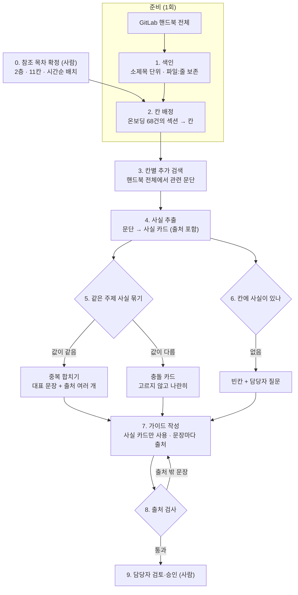

# 온보딩 문서 구조화 에이전트 — 기획·발표 7단계 (검토용 초안)

> 흩어진 사내 온보딩 문서를 모아, **신입이 읽기 좋은 하나의 가이드**로 구조화한다. 같은 사실이 페이지마다 다르면 **고르지 않고 나란히 보여 주고**, 빠진 칸은 담당자에게 묻는다. 모든 문장에 원문 출처를 단다.
>
> 작성 2026-10-01 · 우지훈 · 틀: `docs/기획.md`와 같은 7단계
>
> **📌 이 문서의 위치**: `기획_온보딩.md`(B안, 온보딩 문서 정리·생성 에이전트)를 **"사람이 읽기 좋은 구조화"로 좁혀 상세화한 파생안(B')**이다. B안의 GitLab 분석 결과를 재사용하며, B안 문서는 수정하지 않았다. 주제 결정은 아직 `.agent/DECISIONS.md`에 없다.
>
> **근거 표기**: 📊 B안 문서의 GitLab 핸드북 집계([suuuuuuungho/GitLab_Data](https://github.com/suuuuuuungho/GitLab_Data) 커밋 `0ab0299`, **이 저장소에 재현 스크립트 없음**) · 📣 2026-09-29 LG CNS 현직자 특강 녹취 · 🔍 웹에서 원문을 열어 확인 · ⚠️ 확인 안 된 가정
> 근거 없이 채운 칸은 발표장에서 바로 질문이 들어온다 — 모르면 "아직 없음"이라고 적는다.

---

## 0. "구조화"를 이 문서에서는 이렇게 정의한다

말이 넓어서 먼저 고정한다. 이 에이전트가 하는 **구조화는 다섯 가지 동작**이고, 그 밖의 것은 하지 않는다.

| # | 동작 | 입력 → 출력 | 예 (GitLab) |
|---|---|---|---|
| ① | **모으기** | 흩어진 페이지 → 칸(주제)별 묶음 | 온보딩 이슈 생성 시점이 온보딩 문서와 PM 직무 문서에 나뉘어 있음 |
| ② | **층 나누기** | 칸별 묶음 → 전사 공통 / 팀별 2층 | 계정·권한은 전사 문서에, 팀 도구는 팀 문서에 |
| ③ | **중복 합치기** | 같은 말을 하는 문장들 → 대표 문장 1개 + 출처 여러 개 | — |
| ④ | **충돌 표시** | 값이 다른 문장들 → **충돌 카드** (고르지 않음) | "4일 전" / "4 영업일 전" / "4~10 영업일 전" 📊 |
| ⑤ | **빈칸 표시** | 내용이 없는 칸 → 빈칸 + 담당자 질문 | 팀 문서 다수에 "권한 요청" 내용 없음 📊 |

결과물은 **신입의 시간순**(입사 전 → 첫날 → 첫 주 → 첫 달)으로 칸을 배치한 한 장짜리 가이드다. 사람이 읽는 문서이므로, 무엇을 언제 해야 하는지가 순서대로 보여야 한다.

**하지 않는 것**: 사실을 고치거나 새로 쓰지 않는다. 충돌한 값 중 무엇이 맞는지 정하지 않는다. 원본 문서를 덮어쓰지 않는다. 다른 회사(GitLab)의 사실을 옮겨 오지 않는다.

---

## 1. 문제 정의

### 배경 — 문서를 잘 쓰는 회사조차 온보딩 정보가 흩어져 있다

GitLab은 회사 운영 전부를 공개 핸드북(마크다운 4,612개, 약 612만 단어)으로 관리한다. 그래도 신입 온보딩 정보는 다음처럼 흩어져 있다 📊.

| 관찰 | 수치 | 이 에이전트의 동작 |
|---|---|---|
| "onboarding"으로 찾으면 절반 가까이가 입사와 무관 | 129건 중 61건(47%) — 고객 온보딩·시스템 연결·당직 합류 등 | ① 모으기 (입사 온보딩만 골라냄) |
| 팀 온보딩 페이지 상당수가 링크 한 줄 | 엔지니어링 팀 17개 중 9개가 "이슈 템플릿을 열어라"뿐 | ⑤ 빈칸 표시 |
| 같은 사실이 페이지마다 다름 | 온보딩 이슈 생성 시점 "4일 전" / "4 영업일 전" / "4~10 영업일 전" (`general-onboarding/_index.md:14, 73`, `product-manager-role.md:130`) | ④ 충돌 표시 |
| 팀 문서는 계정·권한을 전사 문서에 맡김 | 팀 문서에서 "권한 요청" 칸 출현 18%, "Day 1 계정·장비" 19% | ② 층 나누기 |
| 실제 체크리스트·사내 링크는 핸드북 밖 | 사내 전용 링크가 페이지 445개(11%)에 836개 | ⑤ 빈칸 표시 ("원문 접근 불가"로 따로 표시) |

📣 특강에서도 같은 구조가 나왔다. PM은 단가가 비싸 "0.2 공수로 5개 프로젝트에 동시 배정"되기도 하고, "회사에선 처음 보는 사람에게 기술·업무를 설명할 일이 매우 많다"고 했다. 설명할 사람은 바쁘고, 문서는 흩어져 있다.

| 항목 | 내용 |
|---|---|
| 1차 대상 (후보) | **신입을 받는 팀 리드·사수** — 신입이 같은 질문을 반복하면 그 답을 매번 해야 하는 사람. 이 에이전트를 돌리고 결과를 승인한다 ⚠️ 미확정 (10절) |
| 수혜자 | **신입·부서 이동자** — 구조화된 가이드를 읽는 사람 |
| 그 사람이 처한 상황 | 온보딩 정보가 전사 문서·팀 문서·직무 문서·외부 도구에 흩어져 있고, 서로 다른 말을 하는 곳도 있다 |
| 없어서 못 하는 것 | "우리 팀 신입이 첫 주에 알아야 할 것"을 **한 장으로, 출처와 함께** 볼 방법 |
| 그래서 무엇이 어렵나 | 신입은 어느 문서가 맞는지 모른 채 묻고, 사수는 같은 답을 반복한다. 문서끼리 다른 말을 해도 아무도 모른다 |
| 현재는 어떻게 때우고 있나 | ⚠️ 아직 조사 없음 — 가설: 사수가 구두로 설명하거나, 팀마다 따로 정리 문서를 만든다 |

**문제 정의 한 문장** (초안):
> 신입을 받는 팀 리드가 / 온보딩 정보가 여러 문서에 흩어지고 서로 다른 말을 하는 상황에서 / 신입에게 줄 정리된 가이드를 만들 수단이 없어서 / 같은 설명을 반복하고, 문서끼리의 모순은 신입이 먼저 발견한다.

⚠️ **사용자 검증 없음.** 1차 대상 인터뷰가 없다. 10/8 전까지 팀 리드·사수 경험자 1–2명에게 "신입이 들어오면 무엇을 반복해서 설명하나"를 확인한다.

### 해결 범위 — 어디까지 풀고 어디부터 안 푸나

| 단계 | 해결 여부 | 비고 |
|---|---|---|
| 0절 다섯 동작(모으기·층 나누기·중복·충돌·빈칸) | ✅ 목표 | GitLab 입사·팀 온보딩 68건 + 핸드북 전체 검색 |
| 시간순 가이드 한 장 + 문장별 출처 | ✅ 목표 | 전사 1장 + 시범 팀 2–3개 |
| 빈칸에 대한 담당자 질문 | ✅ 목표 | 질문만 만든다. 답을 받아 채우는 건 사람 |
| 충돌 값 중 맞는 것 고르기 | ❌ 안 함(의도적) | 판정하지 않는다. 나란히 보여 주고 담당자에게 묻는다 |
| 원본 문서 수정·자동 게시 | ❌ 안 함(의도적) | 원본의 주인은 각 팀이다 |
| GitLab **내용**을 다른 회사에 복사 | ❌ 안 함(의도적) | 구조(칸 목록)만 빌린다. "장비 지원금 1,500달러" 같은 사실은 다른 회사에선 틀린 답 |
| 온보딩 외 사내 문서 전반 | ❌ 이번 범위 밖 | 발표에서 "다음 단계"로만 |
| AI(RAG)가 읽기 좋은 형태로 내보내기 | ⬜ 이번 범위 밖 | 사실 단위 데이터(5절)가 남으므로 확장 가능하다고만 말한다 |
| 핸드북 밖(비공개 템플릿, Google Docs, 슬라이드) 내용 | ❌ 못 함 | 접근 불가 → "원문 접근 불가" 칸으로 표시 |

**실패하는 경우** (지금까지 확인한 것 + 예상):
- 같은 칸을 회사마다 다른 말로 부른다 — Basecamp는 이슈 템플릿 대신 "환영 프로젝트의 할 일 목록", PostHog는 매니저 대신 "team lead" 📊.
- 목차가 한 층이면 모든 팀 문서에 "권한 요청 없음"이라는 잘못된 경고가 뜬다 → ② 층 나누기로 대응 📊.
- **표현만 다르고 같은 뜻**("4일 전" vs "4 영업일 전"이 실제로 같은 규칙일 수도 있음)을 충돌로 잘못 잡을 수 있다 → 충돌 카드는 "다를 수 있음"으로 표시하고 담당자가 확인한다.
- 시점이 다른 문서(옛 규칙이 남은 페이지)는 충돌로 잡히지만 원인은 "갱신 누락"이다. 원인 구분은 하지 않는다.

---

## 2. 유사 서비스 조사 · 차별점

> 2026-10-01 공식 페이지를 열어 확인했다(🔍). 제품을 직접 써 보지는 않았다. 마케팅 문구에만 근거한 칸은 "주장"으로 적었다.

### 상용 도구 — 다섯 동작별 비교

| 도구 | 접근 방식 | 재구성 | 중복 | 충돌 | 빈칸 | 문장별 출처 | 온보딩 지향 |
|---|---|---|---|---|---|---|---|
| [Guru](https://www.getguru.com/features/duplicate-detection) | 검증 흐름이 있는 지식 카드 + AI 답변 | ✗ | ✓ (유사도 90%, 주 1회) | 주장만 | ✓ (주장) | 답변별 출처 목록 | ✗ |
| [Slite](https://slite.com/changelog) | 위키 + Ask/Agent. 병합·재구성을 **제안하고 사람이 승인** | ✓ | ✓ | 확인 안 됨 | ✓ (답 못 한 질문) | 답변별 출처 | ✗ |
| [Tettra](https://tettra.com) | Slack 연동 지식베이스 | ✗ | 확인 안 됨 | 확인 안 됨 | ✓ (답 못 한 질문 → 담당자 티켓) | 확인 안 됨 | ✗ |
| [Document360](https://docs.document360.com/docs/eddy-ai-search-analytics) | 문서 사이트 AI 검색 | ✗ | ✗ | ✗ | ✓ (답 못 한 질의) | 답변 끝 번호 인용 | ✗ |
| [Glean](https://docs.glean.com/user-guide/assistant/ai-answers) | 사내 통합 검색 + AI 답변 | ✗ | ✗ | ✗ | ✗ | 답변 단위 | ✗ |
| [Notion AI](https://www.notion.com/help/wikis-and-verified-pages) | 위키 검증 배지 + AI 질의응답 | ✗ | ✗ | ✗ | ✗ (만료 알림만) | 인용 페이지 | ✗ |
| [Trainual](https://trainual.com/solution/onboarding) | 온보딩·업무 절차 학습 플랫폼 | 일부 | ✗ | ✗ | ✗ | ✗ | ✓ |
| [Scribe](https://scribe.com) | 작업 화면을 캡처해 가이드 생성 | ✗ (새로 만듦) | ✗ | ✗ | ✗ | ✗ | ✓ |
| NotebookLM | 올린 자료로 질의응답·브리핑 문서 | 일부 (학습 가이드·FAQ) | ✗ | ✗ | ✗ | 인라인 인용 (2차 출처) | ✗ |
| SharePoint Knowledge Agent / Confluence Rovo | 메타데이터 제안·요약·질의응답 | 일부 | ✗ | ✗ | SharePoint만 주장 | 확인 안 됨 | ✗ |

**충돌(모순) 탐지 전용**: [Alhena](https://alhena.ai/blog/faq-conflict-detection-ai-knowledge-base/)(고객지원 FAQ의 새 글과 기존 글을 의미로 비교해 **사람에게 플래그만**), [knowledgebase_guardian](https://github.com/datarootsio/knowledgebase_guardian)(벡터 검색 + LLM으로 모순 문서 거부, 개념 증명 수준).

**읽는 법**: 각 동작은 **따로따로 이미 있다.** 중복은 Guru·Slite, 빈칸은 Document360·Tettra·Slite, 답변 단위 인용은 Glean·Notion, 충돌 플래그는 Alhena가 한다. 확인한 범위에서 **목차를 기준으로 여러 문서를 재구성하면서 충돌·빈칸·문장별 출처를 한 번에 내는 도구는 찾지 못했다** — "없다"가 아니라 "못 찾았다"이다.

### 빈칸을 찾는 기준이 다르다

| | 기존 도구 | 이 안 |
|---|---|---|
| 빈칸을 아는 시점 | 누군가 **물었는데 답을 못 했을 때** (사후) | 신입이 묻기 **전에**, 참조 목차와 비교해서 (사전) |
| 결과 | "이 질문에 답이 없음" | "입사 전 준비 칸에 권한 요청 내용이 없음 → 담당자 질문" |

### 학술 근거

| 연구 | 한 일 | 우리와의 관계 |
|---|---|---|
| [CLAIRE / WikiCollide](https://arxiv.org/abs/2509.23233) (EMNLP 2025) | 영어 위키백과 사실의 3.3% 이상이 다른 서술과 모순. LLM이 모순을 **플래그만 하고 편집자가 판단**하게 했더니, 같은 시간에 모순을 64.7% 더 찾았다. 자동 판정만으로는 AUROC 75.1% | **"판정하지 않고 확인 요청만"** 설계의 직접 근거. 자동 판정이 아직 불완전하다는 근거이기도 하다 |
| [ContraDoc](https://arxiv.org/abs/2311.09182) (NAACL 2024) | 긴 문서 안의 자기모순 탐지. GPT-4가 가장 좋았지만 미묘한 모순엔 불안정 | 충돌 탐지 정밀도를 반드시 숫자로 공개해야 하는 이유 |
| [Gokul et al.](https://arxiv.org/abs/2504.00180) (Amazon, 2025) | RAG가 찾아온 문서 묶음 안의 모순을 LLM이 잡는지 평가 — 최신 모델도 어려워함 | 같은 문제의식 |
| B안에서 확인한 STORM·Co-STORM·DocETL 등 | 목차 기반 수집, 빈칸 발견, 단계 분해 | `기획_온보딩.md` 2절 참고 |

**한 줄 차별점**:
> 중복·빈칸·충돌을 각각 잡는 도구는 있다. 우리는 **참조 목차를 기준으로 흩어진 문서를 신입용 가이드 한 장으로 재구성하면서, 충돌은 고르지 않고 나란히 보여 주고, 빈칸은 묻기 전에 먼저 찾고, 모든 문장에 원문 줄을 단다.**

⚠️ 경쟁 도구를 직접 써 보지 않았다. Guru·SharePoint의 충돌·빈칸 기능은 마케팅 문구 근거다. Slite의 Agent(재구성 제안 + 사람 승인)가 가장 가까울 수 있어, 10/6–7에 무료 체험이 되면 확인한다.

---

## 3. 이 기술(RAG)이 왜 들어가야 하는가

| | 그 기술 없이 | 그 기술로 |
|---|---|---|
| **RAG — 핸드북 전체 검색** | 온보딩 문서 68건만 보면 **다른 문서에 흩어진 온보딩 사실**을 놓친다 (예: 이슈 생성 시점이 PM 직무 문서에도 있음 📊). 핸드북 전체(약 612만 단어)는 LLM 한 번에 넣을 수 없다 | 칸마다 핸드북 전체에서 관련 문단을 찾아와 모은다 |
| **RAG — 문장별 출처** | LLM이 정리하면 그럴듯하게 섞고 지어낸다. 어느 문장이 어디서 왔는지 모른다 | 찾아온 문단 안에서만 쓰고, 문장마다 `파일:줄`을 단다. 출처 밖 문장은 버린다 |
| **참조 목차 (GitLab 구조)** | 무엇이 빠졌는지 알 기준이 없다 | 68건에서 반복되는 칸을 기준으로 빈칸을 찾는다 📊 |
| **LLM 의미 판정** | 키워드 규칙은 말이 다르면 놓친다 (Basecamp 시범 11칸 중 3칸 오답 📊) | 의미로 칸을 배정하고, 값이 다른 문장을 충돌 후보로 잡는다 |

B안의 약점은 "문서 68건이 약 6.2만 토큰이라 컨텍스트에 다 들어간다"였다. 이 안은 **68건 밖으로 검색을 넓히는 것**(6절 v2)을 RAG의 이유로 삼는다. 그래서 "68건 밖에서 온보딩 사실이 실제로 얼마나 나오나"를 **v2 실험으로 직접 잰다.** 거의 안 나오면 이 근거는 약해진다 — 결과를 그대로 적는다.

**정직하게 남길 지점**:
- 충돌 탐지는 LLM 판단이라 틀린다. 그래서 충돌 카드는 **판정이 아니라 "확인 요청"**으로만 내보낸다.
- 출처 검사를 붙여도 요약 과정에서 뜻이 바뀌는 경우는 남는다 → 사람 표본으로 비율을 잰다 (6절).

---

## 4. 기술 스택

> 아직 `uv add` 하지 않았다. 아래는 후보이며 10/6–7 프로토타입에서 확정 → DEC로 남긴다. 라이브러리 사용법은 확정 시 공식 문서로 다시 확인한다.

| 레이어 | 선택(후보) | 왜 이걸 골랐나 | 대안과 탈락 이유 |
|---|---|---|---|
| 언어·환경 | Python 3.12 + uv | 저장소에 이미 셋팅 (DEC-004) | — |
| 데이터 | GitLab 핸드북 스냅샷 (`GitLab_Data@0ab0299`) | B안 분석을 그대로 이어받는다 | ⚠️ 핸드북 라이선스 확인 필요 (10절) |
| 청킹 | **마크다운 소제목 단위** + 소제목 경로(`# > ## > ###`) + 줄 범위 보존 | 핸드북은 소제목 구조가 뚜렷하다. 출처 `파일:줄`을 그대로 얻는다 | 고정 길이 — 소제목 중간이 잘려 출처가 어긋남 |
| 검색 | 의미 + 키워드 하이브리드 | "권한 요청", "Day 1" 같은 정확한 용어도 잡아야 한다 (B안과 같은 판단) | 의미 검색만 — 용어 누락 |
| 벡터 저장소 | 로컬(Chroma 등) 또는 PostgreSQL + pgvector | 로컬은 설치만으로 돈다 / pgvector는 GitLab이 문서 2,194개를 운영한 선례 📊 | 프로토타입에서 하나로 정한다 |
| 사실 추출·충돌 판정·요약 | LLM (OpenAI API, 모델은 프로토타입에서 확정) | `.env.example`에 키 자리가 있다 | — |
| 흐름 관리 | Python 스크립트로 단계 순서 실행 | 단계가 선형이고 중간 결과를 파일로 남기면 디버깅이 쉽다 | n8n — 팀 결정으로 제외 (라이선스, B안 4절) |
| 참고 오픈소스 | STORM(`knowledge-storm`), DocETL(`docetl`) — B안에서 확인 | 목차 기반 수집·단계 분해의 근거 | 직접 의존은 프로토타입에서 판단 |
| 화면 | Streamlit | 가이드·충돌 카드·원문 비교 화면을 하루에 만든다 | — |

---

## 5. 아키텍처 · 워크플로우 설계

### 전체 흐름



### 단계별 상세

| 단계 | 하는 일 | 사람/기계 | 산출물 | 실패 시 |
|---|---|---|---|---|
| 0. 참조 목차 | B안의 11칸을 일반 용어로 바꾸고 전사/팀 2층, 시간순으로 배치 | **사람** (팀이 확정) | `outline.yaml` | — |
| 1. 색인 | 핸드북 전체를 소제목 단위로 나누고 경로·줄 범위 저장 | 기계 | 섹션 목록 | — |
| 2. 칸 배정 | 온보딩 68건의 각 섹션을 칸에 배정 (여러 칸 가능, "해당 없음" 가능) | LLM | 섹션 → 칸 | 확신 낮으면 "미배정"으로 남김 |
| 3. 추가 검색 | 칸마다 질의를 만들어 핸드북 전체에서 문단 검색 (68건 밖 포함) | 검색 | 칸별 후보 문단 | — |
| 4. 사실 추출 | 문단에서 "누가/무엇을/언제/조건" 단위 사실을 뽑음 | LLM | 사실 카드 | 출처 줄에 없는 사실은 버림 |
| 5. 묶기·충돌 | 같은 주제의 사실끼리 묶고, 값이 다르면 충돌 카드 | LLM + 규칙 | 대표 사실, 충돌 카드 | 애매하면 충돌 카드로 (놓치는 것보다 묻는 게 낫다) |
| 6. 빈칸 | 사실이 0개인 칸 → 빈칸 + 질문 | 규칙 + LLM(질문 문장) | 빈칸 목록 | — |
| 7. 작성 | 칸별로 사실 카드만 써서 요약. 문장마다 출처 | LLM | 가이드 초안 | — |
| 8. 출처 검사 | 각 문장의 출처가 사실 카드에 있고, 원문 줄에 실제로 있는지 | 기계 | 통과/제거 | 출처 밖 문장은 제거 후 재작성 1회, 그래도 실패면 그 문장 삭제 |
| 9. 승인 | 담당자가 칸별로 승인·수정, 충돌 카드에 답, 빈칸 질문에 답 | **사람** | 확정 가이드 | — |

### 데이터 약속 (파트 사이 입출력)

**섹션** (1 → 2·3)

| 필드 | 예 |
|---|---|
| `section_id` | `people-group/general-onboarding/_index.md#onboarding-issue` |
| `path`, `start_line`, `end_line` | `content/handbook/people-group/general-onboarding/_index.md`, 10, 22 |
| `heading_path` | `General Onboarding > Onboarding Issue` |
| `snapshot` | `GitLab_Data@0ab0299` |
| `text` | 원문 |

**사실 카드** (4 → 5·6·7)

```json
{
  "fact_id": "f-0132",
  "slot": "pre_start",
  "subject": "온보딩 이슈",
  "statement": "입사 4 영업일 전에 생성된다",
  "value": "4 business days before start",
  "source": {"path": "content/handbook/people-group/general-onboarding/_index.md", "start_line": 14, "end_line": 14, "snapshot": "0ab0299"}
}
```

**충돌 카드** (5 → 7·화면)

```json
{
  "conflict_id": "c-007",
  "slot": "pre_start",
  "subject": "온보딩 이슈 생성 시점",
  "facts": ["f-0132", "f-0133", "f-0410"],
  "note": "값이 다를 수 있음 — 담당자 확인 필요",
  "question": "온보딩 이슈는 입사 며칠 전에 생성되나요? 세 문서의 표현이 다릅니다."
}
```

충돌 카드에는 **어느 값이 맞는지 정하는 필드(`correct_fact`, `resolved_value` 등)를 만들지 않는다.** 답은 9단계에서 사람이 준다.

**가이드 칸** (7 → 화면)

```json
{
  "slot": "pre_start",
  "title": "입사 전 준비",
  "layer": "company",
  "order": 1,
  "sentences": [{"text": "온보딩 이슈가 입사 전에 만들어진다.", "facts": ["f-0132", "f-0133"]}],
  "conflicts": ["c-007"],
  "gaps": []
}
```

### 어겨서는 안 되는 설계 제약

1. **근거 없는 문장은 쓰지 않는다** — 가이드의 모든 문장은 사실 카드를 거쳐 원문 `파일:줄`로 이어진다. 없으면 질문한다.
2. **판정하지 않는다** — 충돌한 값 중 맞는 것을 고르지 않는다. "확인 요청"으로만 내보낸다.
3. **GitLab은 구조만 빌린다** — GitLab의 사실(금액·도구명·일정)을 다른 회사 가이드에 넣지 않는다.
4. **추적 가능** — 가이드 문장 → 사실 카드 → 원문 줄 → 스냅샷 커밋을 버리지 않는다.
5. **평가 정답은 사람이 표시한다** — AI가 만든 정답으로 평가하지 않는다 (AGENTS.md 5-2).

---

## 6. 개선 사항 — 지금까지 / 앞으로

> "사람이 읽기 좋다"는 그 자체로 채점할 정답이 없다. 그래서 **네 층으로 나눠** 잰다. 위 세 층은 기계·정답표로, 마지막 층은 사람 과업 시험으로 잰다.

### 평가 설계

| 층 | 무엇을 재나 | 어떻게 | 정답은 어디서 | 지표 |
|---|---|---|---|---|
| A. 근거 충실도 | 가이드 문장이 원문에 있는 말인가 | 출처 줄 존재는 자동 검사. 내용 일치는 문장 표본 30개를 사람이 확인 | 원문 자체 | 출처 존재율, 내용 일치율 |
| B. 정보 보존 | 원문의 중요한 사실이 가이드에서 빠지지 않았나 | 팀원이 원문 온보딩 문서에서 사실 30개를 표시 → 가이드에 있는지 확인 | **팀원 표시** | 보존율(재현율) |
| C. 구조 정확도 | 칸 배정·충돌·빈칸이 맞나 | 아래 정답표와 비교 | **팀원 표시** | 칸 배정 정확도, 충돌 탐지 정밀도·재현율, 빈칸 일치율 |
| D. 사용성 | 신입이 실제로 더 빨리·정확히 찾나 | 과업 시험 (아래) | 과업 질문의 답은 팀원이 원문에서 표시 | 정답률, 소요 시간 |

**C층 정답표** (10/8–10, 사람 작업):
- 칸 배정: 온보딩 문서 섹션 표본 50개에 팀원 2명이 칸을 표시. 둘이 다르면 따로 기록한다.
- 충돌: 팀원이 핸드북에서 찾은 충돌 목록. 출발점은 이미 찾은 "이슈 생성 시점" 1건 📊. 목표 10건 이상, 못 채우면 찾은 만큼만 쓴다.
- 빈칸: B안 계획 그대로 — GitLab이 **아닌** 회사의 공개 온보딩 문서(PostHog, Sourcegraph 등)에 칸별 있음/없음을 표시한다. GitLab으로 GitLab을 평가하면 자기 답안지로 채점하는 셈이기 때문이다.

**D층 과업 시험** (사용성):

```text
과업 질문 10개 (예: "입사 첫날 받아야 할 계정은?", "버디는 누가 정하나?")
   ├─ 세트 1 (5문항) ─ 원본 핸드북으로 찾기  ─┐  참가자 절반은 이 순서
   └─ 세트 2 (5문항) ─ 구조화 가이드로 찾기 ─┘  나머지 절반은 반대 순서
측정: 문항별 정답 여부 · 찾는 데 걸린 시간 · 답을 찾은 출처
```

- 참가자: **교육 과정 동기 6–10명** — 실제 신입과 가장 비슷하고 GitLab 핸드북을 처음 본다. 팀원은 정답을 알기 때문에 제외한다.
- 문항 세트와 도구 순서를 바꿔 가며 배치해, "두 번째라 익숙해서 빨랐다"는 효과를 줄인다.
- 인원이 적어 통계적 결론은 내지 않는다. 🔍 NN/g은 정량 측정에 설계안당 약 20명이 필요하다고 본다([Usability Metrics](https://www.nngroup.com/articles/usability-metrics/)). 6–10명은 **경향을 보는 수준**이므로 **문항별 원자료를 그대로 공개**한다.
- 성공은 "성공 / 부분 성공 / 실패" 단계별 비율로 보고하고, 점수로 바꿔 평균 내지 않는다 (🔍 [NN/g Success Rate](https://www.nngroup.com/articles/success-rate-the-simplest-usability-metric/)).
- ⚠️ 참가자 모집·동의는 10/8–10에 확인해야 한다. 안 되면 D층은 "다음 단계"로 돌리고 A–C층만 발표한다.

0.03 미만 차이는 "같다"로 본다 (`기획.md` 6절 기준).

### 지금까지 한 개선 (B안 작업 이어받음)

| 항목 | before | after | 무엇을 바꿔서 |
|---|---|---|---|
| 온보딩 문서 수집 | "onboarding" 검색 129건 (47% 무관) | 입사·팀 온보딩 68건 (11개 부서) | 건별로 열어 5개 유형으로 분류 📊 |
| 빈칸 찾기 (시범, 평가셋 아님) | — | Basecamp 1건 11칸 중 8칸 일치 | 키워드 규칙. **정답은 AI 시범 표시라 공식 평가셋 아님** 📊 |

### 앞으로의 개선 (측정 가설까지)

| 버전 | 바꿀 것 | 기대 효과 (가설) | 측정 방법 |
|---|---|---|---|
| v0 | 키워드 규칙으로 칸 배정 (B안 시범) | 기준선 | C층 칸 배정 정확도 |
| v1 | 칸 이름 일반 용어화 + LLM 의미 배정 | 말이 달라 놓치던 칸 회수 | C층 칸 배정 정확도, 빈칸 일치율 |
| v2 | + 핸드북 전체 검색 (68건 밖) | 흩어진 사실 추가 수집 → 보존율 상승 | B층 보존율, **68건 밖에서 온 사실 수** |
| v3 | + 충돌 탐지 | 충돌을 사람이 찾은 만큼 잡음 | C층 충돌 정밀도·재현율 |
| v4 | + 출처 검사 | 출처 밖 문장 제거 → 충실도 상승, 보존율은 유지 | A층 내용 일치율, B층 보존율 |
| 최종 | 구조화 가이드 vs 원본 핸드북 | 신입의 정답률 상승·시간 단축 | D층 과업 시험 |

v2가 핵심 실험이다. "RAG가 왜 필요한가"(3절)를 이 숫자가 답한다.

**비용 (유료 API, AGENTS.md 7절)**: 핸드북 전체 임베딩 1회(약 612만 단어) + 칸별 검색·사실 추출·요약. 모델 단가가 정해지면 금액을 계산해 실행 전에 팀에 확인받는다. 전체 색인 전에 표본(온보딩 68건)만 먼저 돌려 보여 준다 (AGENTS.md 5-5).

---

## 7. 어려움과 해결

> 사례를 나열하지 말고 하나의 서사로 엮는다. 위 네 줄은 B안에서 이미 겪은 것이다 📊.

| 언제 | 막힌 지점 | 어떻게 접근했나 | 결과 | 남은 것 |
|---|---|---|---|---|
| 온보딩 문서 수집 | "onboarding" 검색 결과에 고객 온보딩·시스템 연결이 섞임 | 129건을 소제목·본문으로 직접 열어 5개 유형으로 분류 | 입사·팀 온보딩 68건 확정 | 소제목에 단어가 없는 문서는 못 잡음 → v2 전체 검색이 메움 |
| 참조 목차 시범 | 팀 문서에 계정·권한 칸이 거의 없음 (10~19%) | 원인 확인 — 팀 문서는 이 칸을 전사 문서에 맡김 | 목차를 2층으로 나누기로 함 | 2층 목차 확정 (사람 작업) |
| 다른 회사 문서 시험 | 같은 칸을 다른 말로 불러 놓침 | 원문을 줄 단위로 대조 | 칸 이름을 일반 용어로 | LLM 배정으로 개선되는지 측정 (v1) |
| 근거 확인 | 핸드북이 "공개"라던 템플릿 저장소가 실제로는 비공개 | 비로그인 API·파일 접근으로 직접 확인 | 체크리스트 본문은 범위에서 제외 | — |
| (예상) 충돌 판정 | 표현만 다른 같은 규칙을 충돌로 잡을 수 있음 | 판정 대신 "확인 요청" 카드로 | — | v3에서 정밀도로 잰다 |
| (예상) 사용성 시험 | 참가자가 적어 결론이 흔들림 | 문항별 원자료 공개, 순서 교차 배치 | — | — |

**꿰는 한 문장** (초안, B안 계승): 검색 결과도, 문서의 자기소개도 그대로 믿지 않고 — 직접 열어 보고, 숫자로 확인하고, 다른 회사 문서로 시험한다.

---

## 8. 발표 설계

### 데모 시나리오 (2–3분)

1. **before**: 핸드북에서 "onboarding" 검색 → 129건, 절반이 입사와 무관. "신입이라면 어디서부터 읽겠습니까?"
2. **after**: 에이전트가 만든 시간순 가이드 한 장 (입사 전 → 첫날 → 첫 주 → 첫 달)
3. 문장 하나 클릭 → 원문 `파일:줄`이 열림
4. **충돌 카드**: "온보딩 이슈 생성 시점" — 세 문서의 세 가지 표현이 나란히. "우리는 고르지 않습니다. 담당자에게 묻습니다."
5. **빈칸**: 팀 문서에 "권한 요청"이 없음 → 담당자 질문 자동 생성
6. 수치 한 장: v0→v4 지표 + 과업 시험 결과

### 반드시 나올 질문과 답

| 질문 | 답 |
|---|---|
| ChatGPT에 문서 넣고 정리해 달라면 되지 않나? | 핸드북 전체는 한 번에 안 들어가고, 정리 결과의 문장이 어디서 왔는지 모른다. 우리는 v2에서 68건 밖 사실 N개를 더 찾았고, 모든 문장에 출처가 있다 (수치는 실험 후 기입) |
| 충돌을 AI가 판단하면 틀리지 않나? | 그래서 판단하지 않는다. "확인 요청"만 내고, 정밀도를 숫자로 공개한다. 위키백과 연구(CLAIRE)도 자동 판정보다 "AI가 플래그 → 사람이 판단"이 모순을 64.7% 더 찾았다 |
| GitLab 말고 우리 회사에도 되나? | 구조(칸 목록)만 빌렸다. 다른 회사 문서(PostHog 등)로 빈칸 찾기를 시험한 수치가 있다 |
| 정말 읽기 좋아졌나? | 동기 N명 과업 시험의 정답률·시간 (원자료 공개) |
| 비슷한 도구 많지 않나? | 중복·빈칸·충돌을 각각 잡는 도구는 있다(Guru, Slite, Document360, Alhena). 목차 기준으로 재구성하면서 셋을 한 번에, 문장별 원문 줄과 함께 내는 도구는 찾지 못했다. 그리고 기존 도구는 빈칸을 "질문에 답을 못 했을 때" 알지만, 우리는 묻기 전에 찾는다 (2절) |

### 임팩트

```text
절감 = (신입 1명이 정보를 찾는 데 쓰는 시간 단축) × (연간 신입·이동 인원) + (사수의 반복 설명 시간 단축)
```

세 값 모두 아직 없다. 과업 시험의 시간 차이가 첫 번째 값의 근거가 된다. 나머지는 지어내지 않고 "확인 못 함"으로 둔다.

---

## 9. 일정과 역할 (진행계획.md에 맞춤)

| 날짜 | 할 일 | 끝났다고 볼 기준 |
|---|---|---|
| 10/2(금) | 주제 결정 | 채택 시 DEC 기록 |
| 10/6–7 | 프로토타입 | 온보딩 문서 1개 팀에 대해 칸 배정 → 사실 카드 → 가이드 1장이 출처와 함께 나온다 |
| 10/8–10 | 설계 확정·정답표 | 참조 목차 확정 · C층 정답표 · 과업 질문 10개와 답 · 참가자 모집 확인 · 5절 데이터 약속 확정 |
| 10/12–14 | 파트 개발 | 파트별 PR 병합 · v0·v1 수치 |
| 10/15–18 | 개선·시험 | v2 이후 1개 이상 before→after · 과업 시험 실시 |
| 10/19 | 리허설 | 데모 녹화본 |
| 10/20 | 발표 | |

**파트 분담 제안** (확정 아님):

| 파트 | 범위 | 다른 파트와의 약속 |
|---|---|---|
| ① 수집·색인·칸 배정 | 1–3단계 | 섹션 형식 |
| ② 사실·충돌·빈칸 | 4–6단계 | 사실 카드·충돌 카드 형식 |
| ③ 가이드·출처 검사·화면 | 7–8단계, Streamlit | 가이드 칸 형식 |
| ④ 평가 | 정답표 관리, 과업 시험 운영, 수치 표 | 위 형식을 읽기만 함 |

**우선순위** (모자라면 아래부터 줄인다): 가이드+출처 > 빈칸 > 충돌 카드 > 핸드북 전체 검색(v2) > 과업 시험.
단, v2와 과업 시험이 빠지면 3절 "왜 RAG"와 "정말 읽기 좋아졌나"의 답이 약해진다는 것을 알고 줄인다.

---

## 10. 미결정 · 확인 필요

- [ ] 주제 채택 여부 (A 규제 RAG / B 온보딩 문서 / B' 이 안 / C 코드 온보딩) → DEC 기록
- [ ] 1차 대상: 팀 리드·사수 / 인사 담당자 / 신입 본인
- [ ] 참조 목차 확정 (11칸, 2층, 시간순)
- [ ] GitLab 핸드북 라이선스 확인 (데이터 사용·발표 인용 가능 범위)
- [ ] 과업 시험 참가자 모집·동의 (교육 동기 6–10명)
- [ ] 임베딩·LLM·벡터 저장소와 예상 비용
- [ ] 1차 대상 인터뷰 1–2명
- [ ] B안 작성자와 이 파생안의 관계 정리 (B안을 대체 / B안에 합침 / 별도 후보)
- [ ] Slite Agent 무료 체험으로 직접 비교 (가장 가까운 경쟁 기능)
