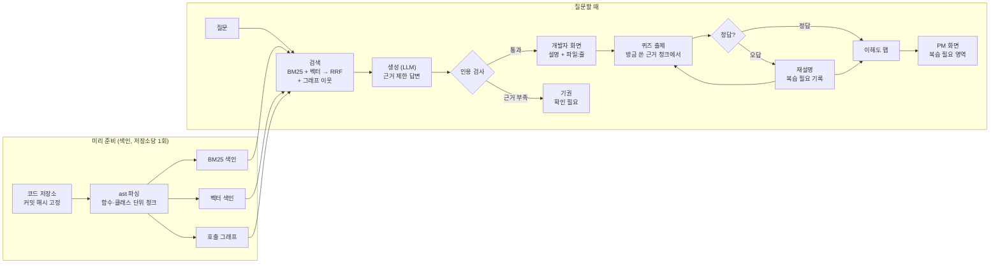

# 코드 이해 도우미 — 기획·발표 7단계 (검토용 초안)

> 신규 투입 개발자에게 프로젝트 코드를 **근거(파일:줄)와 함께 설명하고, 이해했는지 퀴즈로 확인하는** RAG 도구.
>
> 작성 2026-10-01 · 우지훈 · 틀: `docs/기획.md`와 같은 7단계 (원본 `lgcns-ai-campus/notes/project-planning-template.md`)
> 바탕 자료: `lgcns-ai-campus/notes/idea-codebase-onboarding-rag.md`(2026-09-30 상세안), 2026-09-29 LG CNS 현직자 특강 녹취
>
> **📌 이 문서의 위치**: 10/2 주제 결정 회의용 **세 번째 후보(C)**다. 같은 폴더의 `기획_온보딩.md`(B. 사내 온보딩 **문서** 정리·생성 에이전트)와는 다른 안이다. 주제 전환은 아직 `.agent/DECISIONS.md`에 기록되지 않았다.
>
> **근거 표기**: 📣 특강 녹취 실제 발언 · 🔍 웹에서 원문을 열어 확인 · 🧪 개인 이전 프로젝트(공시 RAG) 실측 — **이 저장소에서 재현한 값 아님** · ⚠️ 확인 안 된 가정
> 근거 없이 채운 칸은 발표장에서 바로 질문이 들어온다 — 모르면 "아직 없음"이라고 적는다.

---

## 1. 문제 정의

### 배경

| 항목 | 내용 |
|---|---|
| 1차 대상 | SI 프로젝트에 **중간 투입된 개발자** (자사 + 협력사). 이미 몇 년째 굴러가는 수만 줄짜리 코드베이스를 넘겨받는다 |
| 그 사람이 처한 상황 | 권한 신청은 넣었고 나오길 기다리는 중. 사내 시스템·위키·이슈 트래커에 못 들어간다. 받아 볼 수 있는 건 **소스 코드뿐**이다 |
| 없어서 못 하는 것 | 코드를 **스스로 파악할 길잡이**가 없다. 공식 온보딩 자료는 없거나 낡았고, 물어볼 사람은 자기 일로 바쁘다 |
| 그래서 무엇이 어렵나 | ① 투입 후 **1주~1달을 유휴로 보낸다** ② 설명을 들어도 **이해했는지 아무도 확인하지 않아** 중간 점검에서야 격차가 드러난다 |
| 현재는 어떻게 때우고 있나 | **개인기**. 요령 있는 사람은 옆자리 동료에게 소스를 받아 혼자 읽고, 그렇지 못한 사람은 그냥 기다린다 |
| 2차 대상 | AI로 개발 속도를 올린 개발자 — 만든 코드를 본인이 설명하지 못한다 |

📣 근거 (특강 원문)

> "실제 프로젝트를 하면 그 회사의 권한이 나오기까지 빠르면 일주일 길면 뭐 2주에서 한 달까지 걸리는 경우도 있었어요. 그래서 그동안 사실은 투입해가지고 아무것도 하는 게 없습니다. 거의 그냥 노는 경우도 많이 있는데"

> "아무리 설명을 해도 이분이 뭔가 잘 이해를 못하는 것 같은 거예요. (…) 10번 이상은 한 것 같아요. 동일한 거를. (…) 개발 진행되고 중간에 확인을 하는데 생각보다 너무 화면도 안 나오고 백엔드 기능도 잘 안 된 것 같은 거예요."

> "내가 그 시스템과 로직에 대해서 이해하는 속도보다 개발하는 속도가 빨라서 이해하기가 어렵거든요. (…) PR을 올리는데 어느 어떤 영향을 주고 그거를 퀴즈 형태로 줘가지고 퀴즈를 풀어서 확인하고 이런 작업으로 이해도 높이는 스킬을 제가 만들어서 쓰거든요."

**문제 정의 한 문장**:
> SI 프로젝트에 중간 투입된 개발자가 / 권한이 나오기까지 1주~1달 동안 / 코드베이스를 스스로 파악할 길잡이도, 이해했는지 확인해 줄 사람도 없어서 / 유휴로 시간을 보내고 중간 점검에서야 이해 격차가 드러난다.

⚠️ **사용자 검증 없음.** "권한 대기 중 유휴"는 특강 발언 1건에 기댄 것이다. 얼마나 자주·길게 생기는지는 확인 안 됐다 → 7절 기록 대상, 10/8 전까지 현직자 1–2명 확인.

### 해결 범위 — 어디까지 풀고 어디부터 안 푸나

이 도구는 "코드에 **무엇이 쓰여 있는가**"까지만 다룬다. 판단을 시작하면 틀렸을 때 책임이 생긴다.

| 단계 | 해결 여부 | 비고 |
|---|---|---|
| **찾기** — 이 기능이 어느 파일·함수에 있나 | ✅ 목표 | 근거 `파일:줄` 필수 |
| **읽기** — 데이터 흐름·호출 관계를 근거와 함께 설명 | 🟡 부분 목표 | 정적 코드로 따라갈 수 있는 범위까지 |
| **확인** — 방금 설명한 코드로 퀴즈, 틀리면 재설명 | ✅ 목표 (핵심 차별점) | 객관식·빈칸만. 서술형 채점은 범위 밖 |
| **영향 범위** — 이 함수를 고치면 어디가 영향받나 | 🟡 시연 수준 | 호출 그래프 1–2단계 |
| **판단** — 이 코드가 잘 짜였나, 어떻게 고치나 | ❌ 안 함(의도적) | 코드 리뷰는 별개 문제. 판정 문구 출력 금지 |
| 개발자 역량 평가·인사 자료 | ❌ 안 함(의도적) | 퀴즈가 평가가 되면 사용자가 도구를 피한다. PM 화면은 "어디를 더 설명할지" 용도만 |
| 사내 시스템·위키·이슈 트래커 연동 | ❌ 안 함(의도적) | 바로 그 권한이 없는 기간이 대상이다 |
| 한국어 주석 코드 성능 | ⬜ 미검증 | 공개 평가셋이 전부 영어. 발표에서 분리해 말한다 |
| 사내 구축형(온프렘) 모델 | ⬜ 이번 범위 밖 | 모델 교체가 쉬운 구조로만 만든다 (4절) |

**실패하는 경우** (먼저 말한다):
- 주석이 없고 변수명이 무의미한 레거시 → 설명 품질이 급락한다
- **실행해 봐야 아는 동작** (런타임 설정, 리플렉션·DI 주입, 외부 시스템 연동, 배치 스케줄) → 정적 코드로는 못 따라간다. 호출 그래프에도 안 잡힌다
- 코드가 아니라 **업무 맥락**을 물을 때 ("이 할인 정책이 왜 이렇게 생겼나") → 코드에 답이 없으므로 기권해야 한다
- 정답이 코드에 명확히 없는 개념 → 퀴즈로 낼 수 없다 (출제 자체를 버린다)

---

## 2. 유사 서비스 조사 · 차별점

> 2026-10-01 원문을 열어 확인했다(🔍). 못 찾은 것은 "못 찾았다"로 쓴다 — "경쟁자 없음"과 다르다.

### 상용·오픈소스 도구

| 서비스 | 접근 방식 | 한계 (우리 관점) | 우리의 차별점 |
|---|---|---|---|
| [DeepWiki](https://docs.devin.ai/work-with-devin/deepwiki) (Cognition) | 저장소를 위키·아키텍처 다이어그램으로 자동 정리 + 질의응답 | 물어보면 답하는 방식. 이해 확인 없음 | 퀴즈로 되묻고, 틀린 영역을 기록 |
| Sourcegraph Cody | 코드 검색 + 자연어 질의응답 | 이해 확인 기능 확인 안 됨. 2025-07 무료·Pro 요금제 종료로 엔터프라이즈 전용이 됐다(2차 출처) | 같음 |
| [Greptile](https://www.greptile.com/) | 현재는 AI PR 코드 리뷰 도구 | 리뷰(판단) 도구 — 우리는 판단을 의도적으로 안 함 | 이해 확인 |
| [Unblocked](https://getunblocked.com/) | 코드·대화·이슈를 묶은 AI 에이전트용 맥락 제공 | 사내 시스템 연동 전제 → 권한 없는 기간엔 못 씀 | 소스 코드만으로 동작 |
| [Driver.ai](https://www.driver.ai/) | AI 에이전트용 코드베이스 맥락 생성 | 사람의 이해 확인 없음 | 이해 확인 |
| GitHub Copilot / Cursor | 에디터 안에서 코드 설명(`/explain`, Ask 모드) | 개인 도구. 조직 차원의 이해도 기록 없음, 퀴즈 기능 확인 안 됨 | PM 화면 |
| ⚠️ [Codebase to Course](https://github.com/zarazhangrui/codebase-to-course) (오픈소스, Claude Code 스킬, 스타 약 5.6k) | 저장소를 **인터랙티브 HTML 코스로 바꾸고 퀴즈를 넣는다** ("즐겨찾기를 추가하려면 어느 파일이 바뀌나?") | **가장 가까운 경쟁자.** 다만 README 기준 퀴즈 정답을 코드로 검증하는 장치(`파일:줄` 인용, 자동 검사)가 없고, 학습자 결과 추적·관리자 화면도 없다 | 퀴즈 정답을 **코드로 검증**, 오답 영역을 **PM에게 전달**, 정확도를 **공개 평가셋 수치로** 제시 |
| CodeTours 등 가이드 투어 도구 | 코드 순서대로 둘러보는 투어 생성 | 퀴즈 없음 | 이해 확인 |

**"이해도를 확인하는 도구는 없다"고 말하면 틀린다.** Codebase to Course가 이미 퀴즈를 낸다. 📣 현직자가 직접 만들어 썼다는 발언도 "시장에 없어서"가 아니라 "자기 흐름(PR 영향 퀴즈)에 맞는 게 없어서"로 읽어야 한다.

### 학술 선행연구

| 연구 | 한 일 | 우리와의 관계 |
|---|---|---|
| [RANGER](https://arxiv.org/abs/2509.25257) — Repository-Level Agent for Graph-Enhanced Retrieval | 저장소 전체를 변수 단위까지 **지식 그래프**로 만든다. 이름 질의는 Cypher 조회, 자연어 질의는 MCTS 그래프 탐색. CodeSearchNet·RepoQA에서 임베딩 기준선을 앞섰고, RepoBench에서 파일 간 의존 검색이 좋았다 | 그래프 + 검색이 저장소 단위에서 통한다는 **근거로 인용**. 검색까지이고 이해 확인은 없다 |
| [SWE-QA](https://arxiv.org/html/2509.14635v2) (ACL 2026 Findings) | 저장소 단위 코드 질문 평가셋. 질문 720개, Python 저장소 15개 | 우리 **평가셋** (6절) |
| [Spyder-CodeQA](https://aclanthology.org/2024.acl-srw.28.pdf) (ACL 2024 SRW) | 질문 325개, 의미 이해·**의존 관계 이해**·저장소 메타정보 3유형 | 의존 관계 질문 보조 평가 후보 (6절) |

**한 줄 차별점**:
> 코드를 설명해 주는 도구는 많고 퀴즈를 내는 도구도 있다. 우리는 **퀴즈 정답까지 코드 줄로 검증하고, 틀린 영역을 PM에게 넘기고, 그 정확도를 공개 평가셋 숫자로 보여 준다.**

⚠️ 위 차별점은 README·공개 페이지 기준이다. Codebase to Course를 실제로 돌려 비교한 것은 아니다 → 10/6–7 프로토타입 때 같은 저장소로 한 번 돌려 보고 비교 결과를 7절에 적는다.

---

## 3. 이 기술(RAG + 코드 그래프)이 왜 들어가야 하는가

| | 그 기술 없이 (LLM 단독) | 그 기술로 |
|---|---|---|
| 코드 설명 | 사내 코드는 공개된 적이 없다 → LLM은 **그럴듯하게 지어낸다** | 실제 저장소에서 관련 함수만 찾아와 그 안에서만 설명 |
| 근거 제시 | "어디에 그렇게 쓰여 있나" 확인 불가 | 모든 문장에 `파일:줄` 출처. 사용자가 직접 열어 검증 |
| 퀴즈 생성 | 일반 상식 문제밖에 못 낸다 | **이 프로젝트 실제 코드**에서만 출제 → 채점 근거도 코드 |
| 영향 범위 | 추측 | 호출 그래프를 따라 실제 호출하는 곳을 나열 |
| 식별자 검색 | — | 임베딩만으로는 `getUserById`와 `getUserByEmail`을 잘 못 가른다 → BM25(키워드)를 같이 쓴다 |

**왜 파인튜닝이 아닌가**: 코드베이스는 프로젝트마다 다르고 매일 바뀐다. 투입 때마다 학습을 돌릴 수 없다. 커밋 해시 단위로 색인을 다시 만드는 검색이 맞다.

**왜 벡터 검색만으로 안 되나**: "이 함수를 부르는 곳은?"은 **비슷한 코드**가 아니라 **연결선**을 따라가야 답이 나온다. 지하철 노선도에서 공사 구간의 영향을 보려면 비슷하게 생긴 역이 아니라 선을 따라가야 하는 것과 같다.

```text
   [주문하기] ──호출──> [재고차감] ──호출──> [알림발송]
        │                    │
        └───호출──> [결제]    └──호출──> [통계기록]

   재고차감을 고치면 → 알림발송·통계기록(하위), 주문하기(상위)가 영향받는다
```

**정직하게 남길 지점**:
- 근거 제한 프롬프트와 인용 검사를 붙여도 환각은 남는다. 🧪 같은 구성의 공시 RAG에서 **19.2%가 남았다** (이 저장소 재현 아님). 그래서 6절 v4에서 **기권 설계**로 대응하고, 환각률을 숫자로 공개한다.
- 정적 호출 그래프는 동적 호출(콜백, DI, 리플렉션)을 놓친다. 영향 범위는 "**최소** 이만큼"으로 표시한다.

---

## 4. 기술 스택

> 아직 `uv add` 하지 않았다. 아래는 후보이며 10/6–7 프로토타입에서 확정 → `.agent/DECISIONS.md`에 DEC로 남긴다.
> 라이브러리 사용법은 확정 시 공식 문서로 다시 확인한다 (CLAUDE.md).

| 레이어 | 선택(후보) | 왜 이걸 골랐나 | 대안과 탈락 이유 |
|---|---|---|---|
| 대상 언어 | **Python 1개** | 평가셋(SWE-QA)이 Python 저장소다. 표준 라이브러리 `ast`로 바로 파싱 | Java(SI 현장 주력)는 발표에서 "다음 단계". 다국어는 `tree-sitter`로 확장 가능 |
| 파싱·청킹 | `ast`, **함수·클래스 단위** | 의미 단위가 잘리면 설명이 깨진다. 줄 번호(`lineno`, `end_lineno`)를 그대로 얻는다 | 고정 길이 청킹 — 함수 중간이 잘려 인용 범위가 어긋남 |
| 청크 헤더 | 파일 경로 + 클래스명 + import 목록을 청크 앞에 붙임 | 함수 본문만으로는 "어느 모듈의 무엇"인지 모른다 | — |
| 키워드 검색 | BM25 (`rank-bm25` 등) | 코드 질문은 **식별자 정확 매칭**이 핵심 | — |
| 벡터 검색 | 임베딩 + 로컬 벡터 저장소 (Chroma 또는 FAISS) | 설치만으로 돌고 서버가 필요 없다 | 별도 벡터 DB 서버 — 사흘 개발에 운영 부담 |
| 결합 | RRF (순위 결합) | 점수 단위가 다른 두 검색을 순위로만 합친다 | 가중합 — 가중치 튜닝이 평가셋에 맞춰질 위험 |
| 임베딩 | 후보 ① `BAAI/bge-m3`(로컬) ② OpenAI 임베딩 | ① 🔍 최대 8,192토큰, 100개 이상 언어 지원(한국어는 모델 카드에 명시돼 있지 않아 추정) · 로컬 실행 → 사내망 이식에 유리 ② 설정이 쉽다 | 프로토타입에서 같은 평가셋으로 비교해 정한다 |
| 리랭커 | `bge-reranker-v2-m3` (v2 이후 선택) | 후보를 넓게 가져와 재정렬 | 기본 구성에선 빼고, 개선 실험으로 넣는다 |
| 호출 그래프 | **`networkx`** (메모리 그래프) | 저장소 1–2개 규모면 충분하고, 설치·운영이 없다 | Neo4j — 과정 실습과 이어지지만 서버 운영이 필요. 그래프가 커지거나 Cypher 질의가 필요해지면 전환 |
| LLM | OpenAI API (모델은 프로토타입에서 확정) | `.env.example`에 키 자리가 이미 있다 | 🧪 로컬 양자화 모델은 공시 RAG에서 재현율이 43.2%로 떨어졌다 (이 저장소 재현 아님) |
| 화면 | Streamlit | 파이썬만으로 질의·퀴즈·그래프 화면을 하루에 만든다 | React — 사흘에 프론트까지 하기엔 부담 |
| 그래프 시각화 | Streamlit 컴포넌트 또는 pyvis | "함수 클릭 → 영향 범위가 번져 나감" 시연용 | ⚠️ 프로토타입에서 확인 |
| 평가 | pytest 스타일 평가 스크립트 + SWE-QA | 같은 평가셋 before/after (AGENTS.md 5절) | — |

**보안 전제**: 데모는 공개 코드(SWE-QA 저장소)로만 한다. 고객사 코드는 외부 API로 보내지 않는다는 전제로, LLM·임베딩 호출부를 한 모듈에 모아 사내 구축형 모델로 바꿀 수 있게 만든다.

---

## 5. 아키텍처 · 워크플로우 설계

### 계층

```text
L5  평가 (횡단)      eval/       SWE-QA 답변 정확도 · 인용 검사 통과율 · 퀴즈 품질 표본
L4  화면             app/        Streamlit — 질문 · 퀴즈 · 영향 범위 그래프 · PM 화면
L3  퀴즈 엔진        quiz/       근거 코드로 출제 → 검증 → 결정적 채점 → 이해도 맵 기록
L2b 영향 범위        impact/     호출 그래프 탐색 (이 함수 → 호출하는 곳 / 호출받는 곳)
L2a 설명 엔진        explain/    근거 제한 답변 + 인용 검사 + 기권
L1  검색             retrieval/  BM25(식별자) + 벡터(의미) + RRF (+ 그래프 이웃 확장)
L0  색인             index/      git clone → 커밋 고정 → ast 파싱 → 함수 단위 청크 + 호출 그래프
```

### 전체 흐름



### 데이터 약속 (파트 사이 입출력)

파트를 나눠 사흘에 개발하려면 **파트 사이 데이터 모양을 먼저 고정**해야 한다. 아래가 초안이다.

**청크** (L0 → L1·L2·L3)

| 필드 | 예 | 용도 |
|---|---|---|
| `chunk_id` | `requests@a1b2c3d:src/requests/sessions.py:Session.send` | 고유 키 |
| `repo`, `commit` | `psf/requests`, `a1b2c3d` | 추적 가능성 (원칙 4) |
| `path`, `start_line`, `end_line` | `src/requests/sessions.py`, 673, 750 | 인용·검증 |
| `symbol`, `kind` | `Session.send`, `method` | 검색·그래프 노드 |
| `header` | 경로 + 클래스 + import 요약 | 청크 맥락 |
| `code` | 원문 | 생성·퀴즈 근거 |

**호출 그래프** — 노드 = `symbol`, 간선 = `calls` / `imports` / `inherits`. 이름만으로 연결을 못 정하면(동명이인 함수) 간선에 `resolved: false`를 달고 화면에 "추정"으로 표시한다.

**답변** (L2a → L4)

```json
{
  "question": "로그인 검증은 어디서 하나요?",
  "claims": [
    {"text": "verify_user()가 비밀번호를 확인한 뒤 토큰을 발급한다.",
     "citations": [{"path": "auth/login_service.py", "start_line": 42, "end_line": 58, "commit": "a1b2c3d"}]}
  ],
  "abstained": false,
  "retrieved_chunk_ids": ["..."]
}
```

판정 필드(`is_correct_code`, `should_fix` 등)는 만들지 않는다. `claims[].citations`가 빈 문장은 출력하지 않는다.

**퀴즈** (L3 → L4)

```json
{
  "quiz_id": "...",
  "type": "multiple_choice",
  "question": "비밀번호가 틀렸을 때 verify_user()가 호출하는 함수는?",
  "options": ["reject_login", "handle_error", "retry_auth"],
  "answer_index": 0,
  "evidence": {"path": "auth/login_service.py", "start_line": 51, "end_line": 53, "commit": "a1b2c3d"},
  "topic": "auth"
}
```

### 퀴즈를 믿을 수 있게 만드는 규칙

퀴즈가 핵심 차별점이므로, LLM이 만든 퀴즈를 **그대로 내보내지 않고 코드로 검증**한다.

1. **출제 범위**: 방금 답변에 쓴 근거 청크 안에서만 낸다.
2. **유형 제한**: 객관식·빈칸만 낸다. 정답이 **식별자(함수·클래스·변수 이름) 또는 코드 조각**이어야 한다 → 채점이 결정적이다 (문자열 일치).
3. **정답 검증**: 정답 식별자가 `evidence` 줄 범위 안에 **실제로 나오는지** 코드로 확인한다. 없으면 버린다.
4. **오답 보기 검증**: 오답은 같은 저장소에 실제로 있는 식별자에서 고르되, `evidence` 범위 안에는 **나오지 않아야** 한다 → "오답이 사실은 정답"인 경우를 막는다.
5. **너무 쉬운 문제 거르기**: 질문 문장에 정답 식별자가 그대로 들어 있으면 버린다.
6. 3–5를 통과 못 하면 다시 출제하고, 2회 실패하면 그 주제는 퀴즈 없이 넘어간다 (지어낸 퀴즈보다 퀴즈 없음이 낫다).

### 어겨서는 안 되는 설계 제약

1. **근거 없는 설명 금지** — 인용 없는 문장은 출력하지 않는다. 인용은 `retrieved_chunk_ids` 안의 줄 범위만 허용한다.
2. **판단 금지** — "이 코드는 잘못됐다", "이렇게 고쳐라"를 출력하지 않는다.
3. **모르면 기권** — 근거를 못 찾으면 "확인 필요"로 답한다. 파일·함수 이름을 추측해 채우지 않는다.
4. **추적 가능** — 답변 → 근거 → 커밋 해시 → 원본 위치를 버리지 않는다.
5. **퀴즈 결과는 평가에 쓰지 않는다** — PM 화면은 영역별 "복습 필요" 표시만, 개인 점수표는 만들지 않는다.

---

## 6. 개선 사항 — 지금까지 / 앞으로

> 이 저장소에는 아직 코드가 없다. **지금까지 한 개선은 "아직 없음"**이고, 측정 계획을 먼저 박아 둔다.

### 평가셋

| 무엇을 재나 | 평가셋 | 정답은 어디서 | 지표 |
|---|---|---|---|
| 답변 정확도 | **SWE-QA** 중 저장소 1–2개 문항 (저장소당 48문항) | 벤치마크 제공 정답 | 논문 방식: LLM 심판이 정확성·완전성·관련성·명확성·일관성 5개 차원을 각 20점, 총 100점 |
| 의존 관계 질문 | SWE-QA의 `Dependency tracing`·`Data/Control-flow` 의도 유형 (보조: Spyder-CodeQA `dependency understanding`) | 벤치마크 제공 | v3(그래프) 효과를 따로 잰다 |
| 인용 정확도 | 위 답변 전체 | 코드 자체 (기계 검사) | **인용 존재율** = 인용한 줄이 실제 파일에 있고 검색 결과 안에 있는 비율 |
| 인용 관련도 | 답변 표본 30건 | 팀원 2명이 표시 | 인용 줄이 문장을 뒷받침하는 비율 |
| 퀴즈 품질 | 퀴즈 표본 30건 | 팀원 2명이 표시 | 아래 4항목 모두 통과한 비율 |
| 기권 적절성 | 답 없는 질문 표본 (업무 맥락 질문 등) | 팀원이 작성 — 정답이 아니라 "답이 코드에 없는 질문"이라 AGENTS.md 5-2와 충돌하지 않음 | 기권율 |

**SWE-QA 확인 사항** (🔍 [논문 v2](https://arxiv.org/html/2509.14635v2), [GitHub](https://github.com/peng-weihan/SWE-QA-Bench) Apache-2.0, [HuggingFace](https://huggingface.co/datasets/swe-qa/SWE-QA-Benchmark)):
- 질문 720개 / Python 저장소 15개 / 파일 13,300개 / 함수 142,404개 / 340만 줄 이상. arXiv 초록 페이지는 아직 v1 수치(576개)라서 **인용은 v2 본문 기준**으로 한다.
- 질문 유형: What/Why/Where/How 아래 의도 12개 (예: Feature location, Identifier location, Dependency tracing, Data/Control-flow).
- ⚠️ HuggingFace 데이터에는 `question`·`answer` 두 필드뿐이다. 유형별 집계를 하려면 GitHub 쪽에 유형 표시가 있는지 10/8 전까지 확인한다. 없으면 유형별 비교(v2·v3)는 팀원이 질문을 직접 분류해야 한다.
- 채점 심판으로 LLM을 쓰므로 **심판 호출도 비용**이다. 논문은 차원마다 5회 평가 후 다수결을 쓴다 — 우리는 비용 확인 후 횟수를 정한다.
- ⚠️ Spyder-CodeQA의 의존 관계 문항은 GPT-3.5로 만든 뒤 전문가가 검증한 것이다. AGENTS.md 5-2("평가셋을 AI로 지어내지 않는다")와 맞는지 팀 판단이 필요하다 → 보조 지표로만 쓴다.

**퀴즈 품질 4항목**: ① 정답이 하나뿐인가 ② 근거 줄만 읽고 풀 수 있는가 ③ 근거를 안 읽고는 못 푸는가(너무 쉽지 않은가) ④ 문장이 명확한가. 두 사람 표시가 갈리면 그 건은 따로 기록한다.

0.03 미만 차이는 "같다"로 본다 (기획.md 6절 기준). 🧪 공시 RAG에서 같은 코드·같은 평가셋으로도 재현율이 74.0~80.3%로 흔들렸다 → **같은 설정을 3회 이상 돌려 범위로 보고한다.**

### 지금까지 한 개선 — 성능

| 항목 | before | after | 무엇을 바꿔서 |
|---|---|---|---|
| 아직 없음 | | | |

### 지금까지 한 개선 — 품질

| 항목 | before | after | 무엇을 바꿔서 |
|---|---|---|---|
| 아직 없음 | | | |

### 앞으로의 개선 (측정 가설까지)

| 버전 | 바꿀 것 | 기대 효과 (가설) | 측정 방법 |
|---|---|---|---|
| v0 | LLM 단독 (검색 없음) | — 기준선. "RAG가 왜 필요한가"를 숫자로 보여 줌 | SWE-QA 정확도 |
| v1 | 벡터 검색 + 근거 제한 답변 | v0보다 정확도 상승 | SWE-QA 정확도, 인용 존재율 |
| v2 | + BM25 하이브리드 (RRF) | **식별자가 들어간 질문**에서 검색 재현율 상승 | 질문을 식별자 포함/미포함으로 나눠 비교 |
| v3 | + 호출 그래프 이웃 확장 | **의존 관계 질문**에서만 큰 폭 상승, 나머지는 같음 | 의존 관계 유형 따로 집계 |
| v4 | + 인용 검사·기권 | 환각률 하락, 정확도는 유지 (0.03 이내) | 인용 존재율, 기권율, 정확도 |
| Q1 | 퀴즈 검증 규칙(5절 3–5) 적용 전/후 | 퀴즈 품질 4항목 통과율 상승 | 표본 30건 사람 표시 |

v2·v3을 나눠 재는 이유: "하이브리드를 썼습니다"가 아니라 "식별자 질문에서 재현율이 N%p 올랐습니다"로 **어느 기술이 어디에 기여했는지** 말하기 위해서다.

**비용 (유료 API, AGENTS.md 7절)**: SWE-QA 저장소 2개 ≈ 96문항 가정(720문항 ÷ 15저장소 = 평균 48) → 6개 버전 × 3회 ≈ **답변 생성 약 1,700회 + 같은 수의 심판 채점(차원·반복 수만큼 곱해짐)** + 퀴즈·임베딩. 모델 단가가 정해지면 금액을 계산해 실행 전에 팀에 확인받는다.

---

## 7. 어려움과 해결

> 아직 구현 전이라 **예상 난점 + 기록 규칙**으로 둔다. 📣 강사도 "내가 예전에 어떤 일을 했었지 떠올리는 게 너무 어려웠다"고 했다 — **막힌 날 바로 적는다.**

### 예상 난점

| 예상 난점 | 왜 어려운가 | 첫 접근 |
|---|---|---|
| 청킹 단위 | 함수가 너무 길면 잘리고, 너무 짧으면 맥락이 없다 | 함수 단위 + 헤더(경로·클래스·import). 긴 함수는 줄 범위를 유지한 채 나눈다 |
| 식별자 검색 | 임베딩이 비슷한 이름을 못 가른다 | BM25 병행, v1→v2로 효과 측정 |
| 호출 해석 | `self.foo()`, 같은 이름 함수, 동적 호출 | 이름+클래스로 해석, 못 하면 `resolved:false`로 표시 |
| 퀴즈 품질 | 정답이 코드에 없으면 채점 불가 | 5절 검증 규칙, 실패 시 출제 포기 |
| 평가 비용 | 버전 × 반복 × 문항 수만큼 호출 | 저장소 2개로 제한, 실행 전 비용 확인 |
| 사흘 개발 | 기능이 많다 | 9절 우선순위. 그래프·PM 화면은 축소 가능 |

### 기록 규칙 (지금 정해 둔다)

- 막힌 날 아래 표에 **한 줄이라도** 남긴다: 날짜 / 증상 / 시도 / 결과.
- **기각한 가설도 적는다** (AGENTS.md 5-4). 점수가 올랐는데 버린 것도 이유와 함께 남긴다.
- 안 고치기로 한 결정도 근거와 함께 남긴다.

| 언제 | 막힌 지점 | 어떻게 접근했나 | 결과 | 남은 것 |
|---|---|---|---|---|
| 아직 없음 | | | | |

**꿰는 한 문장**: (개발 후 작성)

---

## 8. 발표 설계

### 임팩트 추정

📣 특강에서 심사 기준 중 하나가 **영향받는 사람 규모**라고 했다 (강사 팀 은상 이유: 대상 6명 vs 타 팀 100~200명).

```text
절감 = (유휴 기간 단축 일수) × (연간 신규 투입 인원) × (일 단가)
```

| 변수 | 값 | 출처 |
|---|---|---|
| 현재 유휴 기간 | 1주 ~ 1달 | 📣 특강 |
| 단축 목표 | 아직 없음 | ⚠️ 인터뷰 필요 |
| 연간 투입 인원 | 아직 없음 | ⚠️ 사내 데이터 필요 |
| 일 단가 | 아직 없음 (📣 "자사가 협력사의 약 2배"라는 발언만 있음) | ⚠️ |

숫자를 지어내지 않는다. 공식만 보여 주고, 못 구하면 "구조는 이렇고 수치는 확인 못 했다"고 말한다.

### 데모 시나리오 (2–3분)

1. SWE-QA 저장소 하나를 고른다 → "이 저장소에 오늘 투입됐다고 가정"
2. 질문 → 답변과 `파일:줄` 근거 → 근거를 클릭해 실제 코드 확인
3. 퀴즈 → 일부러 틀림 → 재설명 → 다시 풀어 맞힘
4. 함수 하나 클릭 → **영향 범위가 그래프에서 번져 나가는 화면** (벡터 검색만으로는 못 만드는 장면)
5. PM 화면 → "이 사람은 ○○ 모듈 복습 필요"
6. 수치 한 장: v0(LLM 단독) → v4 정확도·인용 존재율

데모가 실패할 때를 대비해 녹화 화면을 준비한다 (진행계획 3절).

### 반드시 나올 질문과 답

| 질문 | 답 |
|---|---|
| 고객사 코드를 외부 LLM에 보내도 되나? | 데모는 공개 코드로만 했다. 실제 적용은 사내 구축형 모델 전제이고, 모델 호출부를 한 곳에 모아 교체할 수 있게 만들었다 |
| 비슷한 도구 많지 않나? | 많다. 퀴즈를 내는 오픈소스(Codebase to Course)도 있다. 차이는 퀴즈 정답을 코드 줄로 검증하는 것, 틀린 영역을 PM에게 넘기는 것, 정확도를 공개 평가셋 숫자로 보여 주는 것이다 (2절) |
| 퀴즈가 맞는지 어떻게 아나? | 5절 검증 규칙 + 6절 사람 표본 평가 수치 |
| 한국어 코드에서도 되나? | 아직 모른다. 영어 공개 평가셋 점수와 분리해서 말한다 |

---

## 9. 일정과 역할 (진행계획.md에 맞춤)

| 날짜 | 이 안에서 할 일 | 끝났다고 볼 기준 |
|---|---|---|
| 10/2(금) | 주제 결정 | 채택 시 DEC 기록 |
| 10/6–7 | 프로토타입 | 저장소 1개를 색인하고, 질문 1개에 인용 달린 답변 + 퀴즈 1개가 나온다. 임베딩·LLM 후보 확정 |
| 10/8–10 | 설계 확정 | 5절 데이터 약속 확정 · 평가 대상 저장소·문항 확정 · v0 기준선 측정 · 파트별 이슈 |
| 10/12–14 | 파트 개발 | 파트별 PR 병합 · v1 수치 |
| 10/15–18 | 개선·정리 | v2 이후 1개 이상 before→after · 퀴즈 품질 표본 평가 |
| 10/19 | 리허설 | 데모 녹화본 |
| 10/20 | 발표 | |

**파트 분담 제안** (확정 아님 — 10/8–10에 정한다):

| 파트 | 범위 | 다른 파트와의 약속 |
|---|---|---|
| ① 색인·그래프 | L0, L2b — 파싱, 청크, 호출 그래프, 영향 범위 질의 | 청크·그래프 형식 (5절) |
| ② 검색·답변 | L1, L2a — BM25·벡터·RRF, 근거 제한 답변, 인용 검사, 기권 | 답변 형식 (5절) |
| ③ 퀴즈 | L3 — 출제, 검증 규칙, 채점, 이해도 맵 | 퀴즈 형식 (5절) |
| ④ 화면·평가 | L4, L5 — Streamlit 화면, 평가 스크립트, 수치 표 | 위 세 형식을 읽기만 함 |

**우선순위** (시간이 모자라면 아래부터 줄인다): 인용 답변 > 퀴즈+검증 > 평가 수치 > 영향 범위 그래프 > PM 화면.

---

## 10. 미결정 · 확인 필요

- [ ] 주제 채택 여부 (A 규제 RAG / B 온보딩 문서 / C 이 안) → DEC 기록
- [ ] 평가 대상 SWE-QA 저장소 1–2개
- [ ] 임베딩·LLM 모델과 예상 비용 (6절 호출 수 기준)
- [ ] 그래프 저장: `networkx`로 충분한가, Neo4j가 필요한가
- [ ] 퀴즈 표본 평가를 맡을 팀원 2명
- [ ] 현직자 추가 확인 (권한 대기 빈도·기간)
- [ ] 파트 분담과 발표자
- [ ] SWE-QA GitHub 데이터에 질문 유형 표시가 있는지 (없으면 팀원 분류 필요)
- [ ] 답변 채점 심판 모델과 반복 횟수 (비용)
- [ ] Spyder-CodeQA를 보조 지표로 쓸지 (AI 생성 후 전문가 검증 문항)
- [ ] Codebase to Course를 같은 저장소로 돌려 직접 비교
